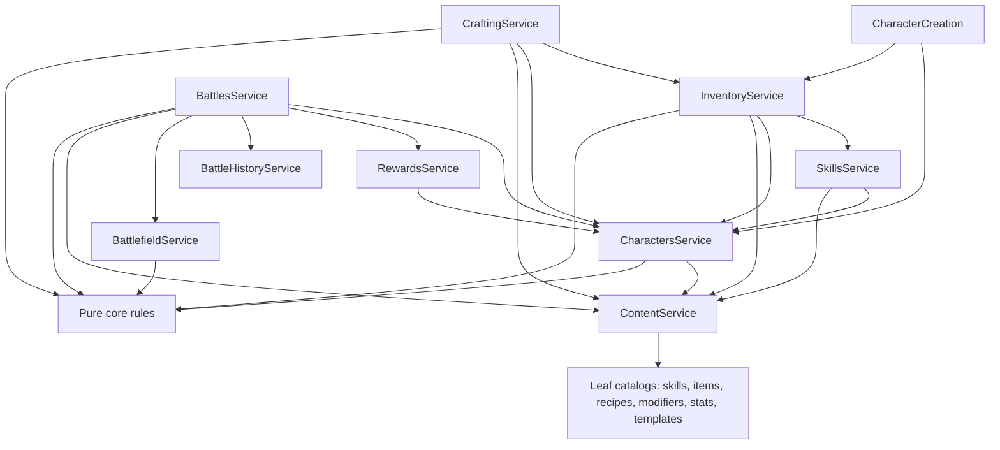
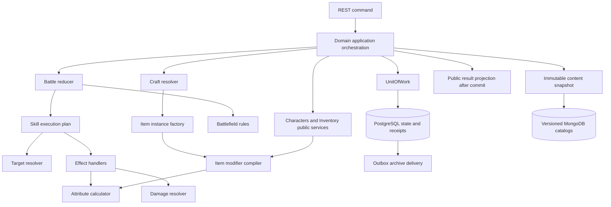
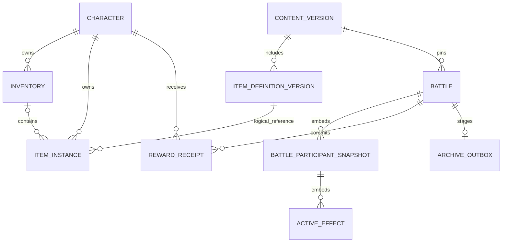
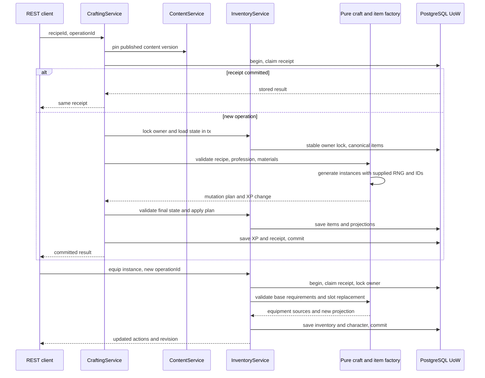
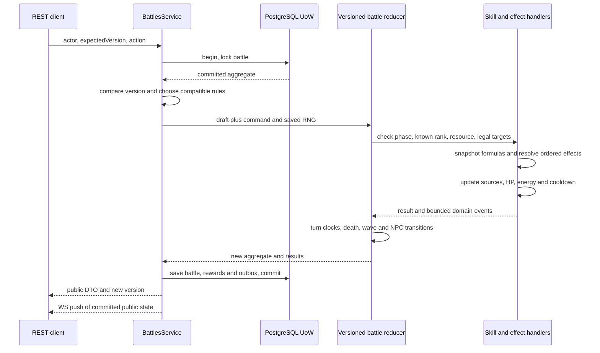
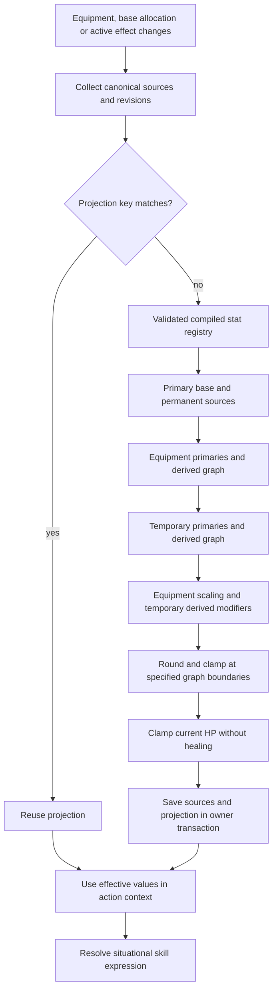

# Аудит игровых механик и хранения состояния

> Исторический аудит состояния разработки до упрощения базовой версии.
> Упоминания legacy-движка, v2, цепочек и корректирующих миграций ниже не являются
> текущими требованиями. Сейчас действует единая предрелизная v1, `/api/v1` и
> одна миграция `init`; источник истины — [architecture.md](../architecture.md)
> и [AGENTS.md](../../AGENTS.md). Новые версии вводятся только по указанию пользователя.


Статус: технический аудит и предложение для обсуждения; рекомендации не являются реализованными изменениями.

Проверенная ревизия: `840c1bfe71e043e02b9fd0e9b4f36f2d03f6dcf8`.
Дата исследования: 31 октября 2026 года.

Дополнительное исследование: [формулы PW и адаптация к пошаговому бою](../combat-formulas.md).
Там закреплена проверенная ревизия публичного исходника и приведены конкретные
формулы. Это не подтверждает их идентичность во всех оригинальных 1.3.6–1.5.5
и не меняет исторические выводы Current Architecture ниже.

Область: характеристики, предметы, экипировка, навыки, эффекты, крафт,
боевые экземпляры и сохранение состояния. Исходный код, конфигурация исполнения,
тесты и схемы БД при подготовке отчёта не изменялись.

Источники правил проекта: [архитектура](../architecture.md),
[характеристики](../character.md), [навыки](../skills.md),
[эффекты](../skill-effects.md), [предметы](../items.md),
[инвентарь](../inventory.md), [развитие предметов и крафт](../item-progression.md),
[бой](../combat.md), [поле](../battlefield.md), [README](../../README.md).
При расхождении описаний фактическое поведение устанавливалось по коду и тестам.

Обозначения: **факт** — установлен по указанному исходнику;
**воспроизведено** — проверено отдельным вызовом существующих чистых функций;
**риск** — следствие кода при описанных условиях, без утверждения о случившемся
инциденте; **предложение** — будущий контракт; **вопрос** — требуется решение.
Рабочие базы, их содержимое, планы SQL и производственная нагрузка не исследовались.

После аудита согласовано и реализовано уточнение модели:
[общие допы](../modifiers.md) и [уровни предметов](../item-progression.md).
Ранг определяет количество допов, itemLevel — их величину; вводятся baseValue,
области применения, индивидуальная редкость крафта и вероятность срабатывания.
Раздел Current Architecture и примеры ранговых множителей ниже описывают
проверенную ревизию, не новую реализацию. В части последующих рекомендаций
по допам приоритет имеют эти доменные документы. Изменения кода выполнены
следующим этапом; сам аудит ниже описывает исходную проверенную ревизию.

## 1. Executive Summary

Проект уже имеет пригодную основу целевой архитектуры: модульный монолит,
чистые игровые расчёты в `packages/core`, разделение определений и экземпляров,
общий механизм модификаторов, составные навыки, сохраняемые временные эффекты,
транзакционный инвентарь, крафт с квитанциями и outbox завершённых боёв.
Переписывание этих подсистем или выделение микросервисов не обосновано.

Практически оптимальное направление — сохранить эти границы и устранить
неоднозначность источников и версий данных:

1. **Версионировать опубликованный контент и проекции.** Сегодня изменение базы
   предмета в MongoDB не обновляет сохранённые источники его бонусов при чтении
   персонажа или старте боя. Пересборка происходит при следующей операции
   инвентаря. Для меча с базой атаки 3 → 6 воспроизведены значения мощности
   `12 → 12 → 16`: до правки, после чтения с новым каталогом, после пересборки.
2. **Зафиксировать версию правил расчёта.** Внутри новых боёв сосуществуют
   простой и составной пути навыков. Эквивалентная формула с критом даёт
   28 и 27 урона из-за порядка округления. Сохранённый контент сам по себе
   не фиксирует алгоритм исполняющего кода.
3. **Завершить модель детерминированности.** Крит имеет сохраняемое состояние
   RNG, поле и автоматические ходы NPC используют `Math.random`. Нельзя
   воспроизвести весь бой только из его исходного снимка и команд. Кроме того,
   внутреннее состояние генератора сейчас возвращается клиенту вместе с `Battle`.
4. **Сохранить существующую атомарность и усилить границу инвентаря.** Крафт
   корректно сохраняет материалы, предметы, XP и квитанцию вместе. Общая фабрика
   экземпляров и общая проверка конечного состояния устранят разницу между
   крафтом, выдачей и будущими наградами предметами.
5. **Уточнить совместимость хранения.** Миграция `007` выдаёт материалы без
   проверки вместимости; `009` такую проверку уже имеет, но прежнее переполнение
   не исправляет. Это отдельный риск обновления старой установки.

Для характеристик рекомендуется гибрид: чистый полный пересчёт из источников
при изменении зависимостей, сохранённая проекция с ревизиями, ситуационные
вычисления при действии. Для навыков — композиция типовых эффектов и небольшое
число программных обработчиков новых механик. Для хранения — PostgreSQL для
постоянного имущества и агрегатов боя, существующий MongoDB для каталогов с
неизменяемыми опубликованными версиями, Redis как восстанавливаемый кэш.
Перенос каталогов в PostgreSQL возможен позже, но для исправления найденных
проблем не обязателен.

Ни одна обнаруженная проблема не доказывает существующее дублирование предметов
или потерю наград при обычных конкурентных командах: такие операции уже
защищены блокировками и уникальными квитанциями. Главные подтверждённые дефекты
относятся к согласованности пересчёта и совместимости алгоритмов.

## 2. Current Architecture

### 2.1. Карта реализации и владельцев

Ссылки на исходные строки закреплены на проверенную ревизию GitHub, чтобы
изменения реализации не смещали доказательства аудита. Существенные функции указаны
отдельно, чтобы вывод можно было проверить после смещения строк.

| Подсистема | Реализация и точка входа | Источник истины |
| --- | --- | --- |
| Персонаж | [CharactersService:20](https://github.com/ShaevAndr/game/blob/840c1bfe71e043e02b9fd0e9b4f36f2d03f6dcf8/apps/server/src/modules/characters/application/characters.service.ts#L20), `get`, `update`; [PostgresCharactersRepository:11](https://github.com/ShaevAndr/game/blob/840c1bfe71e043e02b9fd0e9b4f36f2d03f6dcf8/apps/server/src/modules/characters/repositories/postgres-characters.repository.ts#L11) | PostgreSQL `characters.data` JSONB |
| Создание | [CharacterCreationService.create:16](https://github.com/ShaevAndr/game/blob/840c1bfe71e043e02b9fd0e9b4f36f2d03f6dcf8/apps/server/src/modules/characters/application/character-creation.service.ts#L16) | Персонаж и стартовый инвентарь в одной UoW |
| Развитие | [gainExperience:32](https://github.com/ShaevAndr/game/blob/840c1bfe71e043e02b9fd0e9b4f36f2d03f6dcf8/packages/core/src/progression.ts#L32), [CharacterDevelopmentService.allocate:20](https://github.com/ShaevAndr/game/blob/840c1bfe71e043e02b9fd0e9b4f36f2d03f6dcf8/apps/server/src/modules/characters/application/character-development.service.ts#L20) | База, очки, XP, ревизия персонажа |
| Реестр параметров | [StatDefinition / StatModifier:11](https://github.com/ShaevAndr/game/blob/840c1bfe71e043e02b9fd0e9b4f36f2d03f6dcf8/packages/core/src/attributes/types.ts#L11), [calculateAttributes:80](https://github.com/ShaevAndr/game/blob/840c1bfe71e043e02b9fd0e9b4f36f2d03f6dcf8/packages/core/src/attributes/calculation.ts#L80) | MongoDB `statDefinitions`; сохранённые первичные значения |
| Определения вещей | [ItemDefinition:9](https://github.com/ShaevAndr/game/blob/840c1bfe71e043e02b9fd0e9b4f36f2d03f6dcf8/packages/core/src/items.ts#L9), [MongoItemsRepository:9](https://github.com/ShaevAndr/game/blob/840c1bfe71e043e02b9fd0e9b4f36f2d03f6dcf8/apps/server/src/modules/items/repositories/mongo-items.repository.ts#L9) | MongoDB `items`, `itemGroups`, `itemRanks` |
| Экземпляры и экипировка | [ItemInstance:9](https://github.com/ShaevAndr/game/blob/840c1bfe71e043e02b9fd0e9b4f36f2d03f6dcf8/packages/core/src/inventory.ts#L9), [InventoryService.execute:102](https://github.com/ShaevAndr/game/blob/840c1bfe71e043e02b9fd0e9b4f36f2d03f6dcf8/apps/server/src/modules/inventory/application/inventory.service.ts#L102), [applyInventoryCommand:60](https://github.com/ShaevAndr/game/blob/840c1bfe71e043e02b9fd0e9b4f36f2d03f6dcf8/packages/core/src/inventory.ts#L60) | PostgreSQL `inventories`, `item_instances` |
| Генерация свойств | [qualityForItem:67](https://github.com/ShaevAndr/game/blob/840c1bfe71e043e02b9fd0e9b4f36f2d03f6dcf8/packages/core/src/item-progression.ts#L67), `rankedItemDefinition`, `equipmentAttributeSources` | Снимок ранга и выпавших допов в `item_instances.quality` |
| Каталог навыков | [Skill:33](https://github.com/ShaevAndr/game/blob/840c1bfe71e043e02b9fd0e9b4f36f2d03f6dcf8/packages/core/src/types.ts#L33), [MongoSkillsCatalogRepository:9](https://github.com/ShaevAndr/game/blob/840c1bfe71e043e02b9fd0e9b4f36f2d03f6dcf8/apps/server/src/modules/skills/repositories/mongo-skills-catalog.repository.ts#L9) | MongoDB `skills` |
| Изученные навыки | [SkillsService:23](https://github.com/ShaevAndr/game/blob/840c1bfe71e043e02b9fd0e9b4f36f2d03f6dcf8/apps/server/src/modules/skills/application/skills.service.ts#L23), [skillLevel / upgradeSkill:5](https://github.com/ShaevAndr/game/blob/840c1bfe71e043e02b9fd0e9b4f36f2d03f6dcf8/packages/core/src/skills.ts#L5) | `characters.data.learnedSkillIds`, `skillLevels` |
| Применение навыка | [applyMatchedAction:59](https://github.com/ShaevAndr/game/blob/840c1bfe71e043e02b9fd0e9b4f36f2d03f6dcf8/packages/core/src/combat/matched.ts#L59), [applySkillEffects:31](https://github.com/ShaevAndr/game/blob/840c1bfe71e043e02b9fd0e9b4f36f2d03f6dcf8/packages/core/src/effects/skill-effects.ts#L31) | Боевой агрегат |
| Выражения и цели | [evaluateEffectExpression:4](https://github.com/ShaevAndr/game/blob/840c1bfe71e043e02b9fd0e9b4f36f2d03f6dcf8/packages/core/src/formulas/effect-expression.ts#L4), [resolveSkillTargets:14](https://github.com/ShaevAndr/game/blob/840c1bfe71e043e02b9fd0e9b4f36f2d03f6dcf8/packages/core/src/targeting/index.ts#L14) | Чистые функции и снимок контента боя |
| Общие модификаторы контента | [ModifierDefinition:17](https://github.com/ShaevAndr/game/blob/840c1bfe71e043e02b9fd0e9b4f36f2d03f6dcf8/packages/core/src/item-progression.ts#L17), [MongoModifierDefinitionsRepository:8](https://github.com/ShaevAndr/game/blob/840c1bfe71e043e02b9fd0e9b4f36f2d03f6dcf8/apps/server/src/modules/effects/repositories/mongo-modifier-definitions.repository.ts#L8) | MongoDB `modifierDefinitions`, владелец `effects` |
| Бафы и дебафы | [ActiveEffect:27](https://github.com/ShaevAndr/game/blob/840c1bfe71e043e02b9fd0e9b4f36f2d03f6dcf8/packages/core/src/effects/types.ts#L27), [applyStatEffect / endEffectTurn:38](https://github.com/ShaevAndr/game/blob/840c1bfe71e043e02b9fd0e9b4f36f2d03f6dcf8/packages/core/src/effects/lifecycle.ts#L38) | `Battle.fighters[].activeEffects`, локальные часы и `effectSequence` |
| Рецепты и профессии | [CraftingRecipe:13](https://github.com/ShaevAndr/game/blob/840c1bfe71e043e02b9fd0e9b4f36f2d03f6dcf8/packages/core/src/crafting.ts#L13), [MongoRecipesRepository:10](https://github.com/ShaevAndr/game/blob/840c1bfe71e043e02b9fd0e9b4f36f2d03f6dcf8/apps/server/src/modules/crafting/repositories/mongo-recipes.repository.ts#L10) | MongoDB `recipes`, `professions`, `rankProfiles` |
| Крафт | [CraftingService.apply / blind:50](https://github.com/ShaevAndr/game/blob/840c1bfe71e043e02b9fd0e9b4f36f2d03f6dcf8/apps/server/src/modules/crafting/application/crafting.service.ts#L50), [applyCraftRecipe:86](https://github.com/ShaevAndr/game/blob/840c1bfe71e043e02b9fd0e9b4f36f2d03f6dcf8/packages/core/src/crafting.ts#L86) | Инвентарь, `characters.data.craftingProfessionXp`, `crafting_operations` |
| Бой | [BattlesService.mutate:49](https://github.com/ShaevAndr/game/blob/840c1bfe71e043e02b9fd0e9b4f36f2d03f6dcf8/apps/server/src/modules/battles/application/battles.service.ts#L49), [Battle:137](https://github.com/ShaevAndr/game/blob/840c1bfe71e043e02b9fd0e9b4f36f2d03f6dcf8/packages/core/src/types.ts#L137) | PostgreSQL `battles.data`, `battles.version` |
| Поле | [BattlefieldEngine:35](https://github.com/ShaevAndr/game/blob/840c1bfe71e043e02b9fd0e9b4f36f2d03f6dcf8/packages/core/src/battlefield/types.ts#L35), `core/battlefield`, серверный `BattlefieldService` | Поле и конфигурация в снимке боя |
| Награды | [RewardsService.award:14](https://github.com/ShaevAndr/game/blob/840c1bfe71e043e02b9fd0e9b4f36f2d03f6dcf8/apps/server/src/modules/rewards/application/rewards.service.ts#L14) | `battle_rewards`, персонажи, общий TransactionContext |
| История | [BattleHistoryService:21](https://github.com/ShaevAndr/game/blob/840c1bfe71e043e02b9fd0e9b4f36f2d03f6dcf8/apps/server/src/modules/battle-history/application/battle-history.service.ts#L21) | Outbox PostgreSQL, архив MongoDB, доставка BullMQ |
| Сборка контента | [ContentService.get:32](https://github.com/ShaevAndr/game/blob/840c1bfe71e043e02b9fd0e9b4f36f2d03f6dcf8/apps/server/src/modules/content/application/content.service.ts#L32) | Несколько MongoDB-каталогов; Redis TTL 30 секунд |

`effects` на сервере — каталог параметризованных модификаторов, а не отдельный
сервис хранения активных бафов. Это правильное различие: сроки и активные
экземпляры находятся внутри боя.

### 2.2. Фактические зависимости

Стрелка означает «вызывает публичный application-сервис / зависит от модуля».
Каталог и сервис изменения персонажа показаны раздельно.



Источники DI: [BattlesModule:16](https://github.com/ShaevAndr/game/blob/840c1bfe71e043e02b9fd0e9b4f36f2d03f6dcf8/apps/server/src/modules/battles/battles.module.ts#L16),
[InventoryModule:11](https://github.com/ShaevAndr/game/blob/840c1bfe71e043e02b9fd0e9b4f36f2d03f6dcf8/apps/server/src/modules/inventory/inventory.module.ts#L11),
[CraftingModule:13](https://github.com/ShaevAndr/game/blob/840c1bfe71e043e02b9fd0e9b4f36f2d03f6dcf8/apps/server/src/modules/crafting/crafting.module.ts#L13),
[ContentModule:16](https://github.com/ShaevAndr/game/blob/840c1bfe71e043e02b9fd0e9b4f36f2d03f6dcf8/apps/server/src/modules/content/content.module.ts#L16),
[CharactersModule:12](https://github.com/ShaevAndr/game/blob/840c1bfe71e043e02b9fd0e9b4f36f2d03f6dcf8/apps/server/src/modules/characters/characters.module.ts#L12).

Цикл `characters → content → characters` предотвращён: Content читает
`CharacteristicsCatalogModule` и `CharacterTemplatesModule`, а не
`CharactersModule`. Аналогично разделены `SkillsCatalogModule` и `SkillsModule`,
`CraftingCatalogModule` и `CraftingModule`. Пустые дополнительные слои не нужны.

Циклических импортов серверных и клиентских файлов проверка архитектуры не
обнаружила. Дополнительный обход статических value-import/export в core также
не обнаружил циклов; это не доказательство отсутствия всех семантических
зависимостей. Штатный [check-architecture:22](https://github.com/ShaevAndr/game/blob/840c1bfe71e043e02b9fd0e9b4f36f2d03f6dcf8/scripts/check-architecture.mjs#L22)
сканирует `apps/server/src` и `apps/web/src`, но не `packages/core`.
Основная связанность здесь содержательная: многие сценарии получают весь
`Content`, а инвентарь знает о выдаче навыков свитками.

На клиенте `features/*/api` и `model` обслуживают транспорт и состояние;
боевые компоненты используют серверные `skillChoices`, `targetIds` и previews.
[useBattle:16](https://github.com/ShaevAndr/game/blob/840c1bfe71e043e02b9fd0e9b4f36f2d03f6dcf8/apps/web/src/features/battles/model/useBattle.ts#L16) загружает
REST-снимок, перепроверяет его после WS-подписки и каждые 5 секунд.
WS передаёт обновления открытого боя, игровые команды выполняются через REST.
Повторять расчёт исходов на клиенте не требуется.

### 2.3. Характеристики: фактический жизненный цикл

**База.** Первичные значения — `baseAttributes`, очки — `attributePoints`,
формат — `attributeVersion`, ревизия распределения — `attributeRevision`.
Пять текущих параметров: сила, ловкость, интеллект, выносливость, удача.
Определения и формулы находятся в реестре; производные `attributes` и старые
`stats` сохраняются в JSON персонажа как проекции.

**Уровень.** [gainExperience:35](https://github.com/ShaevAndr/game/blob/840c1bfe71e043e02b9fd0e9b4f36f2d03f6dcf8/packages/core/src/progression.ts#L35)
для новой модели выдаёт пять свободных очков и повышает ревизию, но не
распределяет значения автоматически. Для старой модели остаётся `statGrowth`.
[normalizeCharacter:28](https://github.com/ShaevAndr/game/blob/840c1bfe71e043e02b9fd0e9b4f36f2d03f6dcf8/packages/core/src/progression.ts#L28) дополняет
старые записи при чтении; [projectCharacterAttributes:11](https://github.com/ShaevAndr/game/blob/840c1bfe71e043e02b9fd0e9b4f36f2d03f6dcf8/packages/core/src/attributes/character.ts#L11)
заполняет отсутствующую базу и выполняет пересчёт. Чтение само по себе не
сохраняет нормализацию; последующая запись сохраняет её идемпотентно.

**Экипировка.** `equipmentAttributeSources` собирает четыре источника:
исторические `bonuses`, `statModifiers`, `scaledBonuses` и выпавшие `quality.affixes`.
Ранговый множитель усиливает базу вещи; допы добавляются отдельно.
`InventoryService.commit` сохраняет имущество и обновляет проекции персонажа
в той же транзакции.

**Временные эффекты.** `refreshEffectAttributes` заново строит список
модификаторов из `activeEffects`; `replaceFighterModifiers` пересчитывает все
этапы и ограничивает текущее HP новым максимумом. Прибавка maxHp не лечит,
уменьшение не воскрешает погибшего.

**Пассивные навыки.** Отдельного вида пассивного навыка и сборщика его постоянных
источников в проверенном `Skill` и `projectCharacterAttributes` нет.
Калькулятор уже принимает `permanentModifiers`; в бою они используются,
в частности, адаптером старых NPC. Наличие этого входа не означает наличие
реализованной системы пассивов персонажа.

Порядок расчёта в [calculateAttributes:101](https://github.com/ShaevAndr/game/blob/840c1bfe71e043e02b9fd0e9b4f36f2d03f6dcf8/packages/core/src/attributes/calculation.ts#L101):

1. Базовые первичные и постоянные источники; производные по графу формул.
2. Экипировка первичных, пересчёт зависимых производных, прямые и масштабируемые
   источники экипировки.
3. Временные первичные, пересчёт зависимостей, экипировка, временные производные.

Для масштабирования вычисляется отдельная `intrinsic`-проекция без бонусов
производных от экипировки/временных источников; оружие не усиливает собственную
мощь циклически. Реестр допускает до 64 параметров, глубину зависимостей до 16,
до 32 слагаемых формулы; неизвестные ссылки и циклы отклоняются.

| Вопрос о модификаторах | Ответ по реализации |
| --- | --- |
| Можно добавить характеристику данными? | Да, в пределах реестра, линейных формул и допустимых единиц. Новое поведение вроде уклонения требует кода потребителя. Боевые обязательные параметры перечислены в `contentSchema`, `types.ts:68`. |
| Можно добавить операцию данными? | Нет. `add_flat`, `add_percent`, `multiply`, `set` входят в схемы и калькулятор. Новая операция требует осознанной семантики и тестов; это разумное ограничение. |
| Несколько источников? | Да: уникальный `id`, `sourceId`, три набора источников и масштабирование. |
| Порядок задан? | Да: плоские → сумма процентов → произведение множителей → выигравший `set`; этапы применяются последовательно. |
| Как выбирается `set`? | Максимальные `priority`, затем `appliedSequence`, затем ID; [applyModifiers:61](https://github.com/ShaevAndr/game/blob/840c1bfe71e043e02b9fd0e9b4f36f2d03f6dcf8/packages/core/src/attributes/calculation.ts#L61). |
| Как отменяется источник? | Удалением из действующего набора и полным пересчётом, без обратного вычитания. |
| Как исключается дрейф? | Источники не прибавляются повторно к прошлому итогу. Рациональная арифметика BigInt и ограниченное округление внутри графа. |

**Повторные вычисления.** Один `calculateAttributes` строит три слоя, каждый
раз проверяя и сортируя реестр. `CharactersService.get` нормализует запись;
`InventoryService.commit` вызывает `characters.update`, а внутри callback ещё
раз `projectCharacterAttributes`. `characterFighter` также проецирует уже
прочитанного героя. Это повторные вызовы одной реализации, а не независимые
формулы. Для текущих лимитов это прежде всего упрощение, а не доказанная
проблема производительности. Профилирования нет.

### 2.4. Предметы, генерация и надевание

Разделение definition/instance **уже существует**. В определении правильно
находятся имя, группа, stackLimit, слот, требования, базовые и масштабируемые
бонусы, лечение или выдаваемый навык. В экземпляре — UUID, `itemId`, владелец,
контейнер, количество, надетый слот, снимок ранга и допов. Заточка, камни,
прочность и опознание описаны как будущие этапы; в текущий экземпляр не входят.

Генерация в `qualityForItem`:

- фиксированный ранг либо распределение `chanceBps` на уровне профессии;
- сумма вероятностей рангов 10000, рост верхних вероятностей проверяется;
- число допов задаёт ранг, сейчас 0–6, `affixCount = order − 1`;
- выбор разных определений без возвращения, равновероятно внутри пула;
- целочисленное значение равномерно в включительном диапазоне `minValue..maxValue`;
- флаги `allowWeapon` и `allowArmor`, но категория определяется жёстким
  сравнением `groupId === 'weapons' | 'equipment'`;
- snapshot хранит `effectId`, `effectVersion`, имя, statId, операцию, значение
  и параметры ранга; база `ItemDefinition` целиком не фиксируется.

Нет весов отдельных допов, семейств взаимоисключения, бюджета силы,
зависимости диапазона допа от профессии или сложных ограничений сочетаний.
Это границы нынешнего генератора, а не ошибки. Профессия влияет на ранг;
ранг — на базу и количество допов. Программного класса на каждый меч нет.
Генерация уже управляется таблицами, но не полностью независима от групп.

Надевание: `execute` получает квитанцию → определяет владельцев → блокирует
персонажей в порядке ID → загружает канонический инвентарь → проверяет
требования по `baseAttributes` → чисто заменяет слот → проверяет вместимость →
сохраняет вещи и проекции → фиксирует результат операции.

Сила 40, вещь «требует 50, даёт 10» **не позволяет надеть себя**. Предметы,
уже надетые вещи и временные бафы не помогают выполнить требования: проверяется
сохранённая первичная база, [equipmentRequirementBlockers:54](https://github.com/ShaevAndr/game/blob/840c1bfe71e043e02b9fd0e9b4f36f2d03f6dcf8/packages/core/src/inventory.ts#L54)
и [InventoryService:117](https://github.com/ShaevAndr/game/blob/840c1bfe71e043e02b9fd0e9b4f36f2d03f6dcf8/apps/server/src/modules/inventory/application/inventory.service.ts#L117).
Рекурсивного «снимать предметы до стабилизации» сейчас не требуется.
Понижение базы/сброс распределения не реализованы. Перед их добавлением нужно
определить обработку уже надетых вещей; молча сохранять недопустимый комплект нельзя.

Доступность действий возвращается сервером, но не является разрешением на
мутацию: требования проверяются повторно в транзакции. Проверка требований
сейчас находится в application-сценарии, а не внутри `applyInventoryCommand`;
новый внутренний путь экипировки должен использовать тот же сценарий.

### 2.5. Навыки: структура, исполнение и ограничения

| Аспект | Фактическая модель |
| --- | --- |
| Идентичность | `Skill.id`; изученные ID и ранги отдельно в персонаже |
| Развитие | `progression.maxLevel`, `pointCost`, `powerPerLevel`; для составных выражений `weightPerRankBps`; предел ранга 10 |
| Обучение | Очки, уровень персонажа, prerequisites, старые `learning.stats` и новые `learning.requirements`; база без экипировки |
| Улучшение | Известный навык, предел ранга, очки, `expectedLevel`; новых требований персонажа по рангам нет |
| Применение | Известность, активный участник, фаза, прямое совпадение элемента, энергия, cooldown, живая допустимая цель |
| Цена | Одно `cost` для всех рангов, энергия общего боевого ресурса; текущие требования обучения при касте не перепроверяются |
| Цели | self, одиночный союзник/противник, все союзники/противники; caster-recipient у отдельных эффектов |
| Формула | Простой `power` + рост ранга либо ограниченное выражение от caster/target |
| Эффекты | damage, heal, stat_modifier, dispel; до 16 инструкций |
| Завершение | Синхронно внутри команды, затем переход хода; асинхронного cast/channel состояния нет |

Описание отделено от исполнения: навыки лежат в MongoDB, общие исполнители —
в core. Однако **одного нормализованного пути исполнения пока нет**:
`matched.ts` ветвится по наличию `effects[]`, простой урон вызывает `damage`,
составной — `applyResolvedDamage`. `legacy.ts` отдельно обслуживает старые бои.
Не следует смешивать необходимость legacy-совместимости с двумя путями внутри v2.

Фактический порядок составного каста:

1. `BattlesService.command` проверяет формат; `mutate` блокирует бой и версию.
2. `applyMatchedAction` проверяет актёра, фазу, элемент и доступность.
3. Создаётся черновик всего боя, проверяется выбранная цель.
4. Энергия, cooldown и `usedSkill` меняются только в черновике.
5. `resolveEffects` вычисляет величины **всех** инструкций до первой мутации.
6. Инструкции выполняются в порядке массива; защита читается уже после
   предыдущих дебафов, атакующая величина и источник крита — из снимка каста.
7. Мёртвый получатель пропускается последующими инструкциями; снимаются его эффекты.
8. Обрабатывается завершение хода, затем автоматические действия NPC.
9. Бой, награды и outbox коммитятся; после коммита публикуется WS-снимок.

Случайность сейчас — критический бросок каждого разрешённого эффекта урона,
если `canCrit` разрешён. Отдельного попадания/уклонения, вероятности наложения,
проверки status-resist или interrupt нет. Сопротивление — вычитаемая защита
физического либо конкретного магического типа; временная защита поля тоже
вычитается. Относительное сопротивление из будущей части `skill-effects.md`
не реализовано. Эти правила нельзя приписывать Perfect World.

Многоударность можно описать несколькими `damage` в массиве: отдельные криты,
прибавка `physicalDamageFlat` на каждый удар и получателя, пропуск дальнейших
ударов по погибшему. Это не система реактивных дополнительных атак. Нет
межкомандного прерывания текущего каста: HTTP-команда выполняется атомарно.
Связь навыков сейчас — prerequisites, cooldowns, общий ресурс и эффекты.

### 2.6. Бафы и дебафы

Эффекты уже являются самостоятельной **чистой подсистемой**, а не классами
внутри каждого навыка. Единица владения состоянием остаётся `Battle`.

| Вопрос | Фактическое поведение |
| --- | --- |
| Создание | `applyStatEffect` вычисляет боевой ID из `battle.id` и `effectSequence`, фиксирует источник, ранг, величину и срок |
| Длительность | 1–20 собственных ходов получателя; число или выражение |
| Начало хода | В `nextTurn` повышается `turnsStarted`, сбрасывается guard, уменьшаются cooldowns |
| Конец хода | `endEffectTurn` уменьшает срок при достижении `eligibleFromTurn`; уже текущий при наложении ход не считается |
| Повтор | refresh, replace_if_stronger, stack, independent; общий ключ по умолчанию `skillId:effectId` |
| Стэки | Для аддитивных stack — свежая величина × число стэков, общий обновлённый срок; independent хранит отдельные сроки |
| Источники | По умолчанию общая группа не включает ID caster: разные персонажи могут обновить одну группу; источник последнего экземпляра сохраняется |
| Связь с параметрами | `activeEffects` → `temporaryModifiers` → полный пересчёт, без дрейфа |
| Снятие | dispel по polarity/tags, старейшие сначала; снятие неснимаемого запрещено |
| Смерть | Эффекты на погибшем удаляются, его эффекты на других продолжаются |
| Реакции | Нет подписок `OnDamage*`, `OnSkillUsed`, `OnCharacterDeath`; сроки вызываются явно |

На бойце максимум 64 активных эффекта, в расчёте максимум 512 модификаторов.
Ограничения есть, но общий event budget пока не нужен: цепочки реакций отсутствуют.
Добавление reflection/proc/DoT потребует отдельного ограниченного механизма,
а не публикации синхронных глобальных NestJS-событий из каждого изменения HP.

### 2.7. Крафт и согласованность операций

Рецепт содержит ingredients, outputs, профессию, требуемый её уровень, XP,
`knownByDefault`, политику ранга каждого результата. Персональная книга рецептов,
денежная цена, требования характеристик/уровня персонажа и отдельный шанс
успеха обычного рецепта отсутствуют. Обычный подходящий рецепт успешен;
слепой эксперимент использует `successBps`/`lossBps` и точный набор материалов.

`CraftingService.apply` и `blind`:

- читают свежий контент до UoW;
- вставляют/блокируют квитанцию операции, сверяют signature, возвращают прежний
  результат при повторе без нового броска;
- через `InventoryService.state` блокируют владельца и загружают вещи;
- проверяют рецепт, известность и уровень профессии;
- чистый расчёт клонирует инвентарь, списывает материалы из основного рюкзака,
  создаёт результат и проверяет **конечную** вместимость;
- ранг берётся по уровню профессии **до** начисления XP;
- одним TransactionContext сохраняются инвентарь, проекции, XP и квитанция.

Защита от гонок — блокировка строки персонажа всеми штатными мутациями имущества,
а не отдельные row-lock всех предметов. PostgreSQL-квитанция использует INSERT
ON CONFLICT и SELECT FOR UPDATE. Разные operationId также сериализуются по
владельцу. Неверный ID повтора с другим телом — 409; доменная ошибка — 400,
неизвестный рецепт — 404. Ошибка сохранения откатывает и выдачу, и материалы.
`CraftCompleted` как отдельное структурированное событие сейчас не публикуется.

Внедряемые `roll(max)` и `newId()` позволяют воспроизводить генерацию чистых
функций. В production крафт использует `crypto.randomInt` и UUID. После
отката до коммита повтор может получить новый результат: квитанция и броски
не были зафиксированы. После коммита результат неизменен. Это различие нужно
сохранить явно в контракте, а не обещать повторяемость незавершённого запроса.

### 2.8. Фактическое хранение

| Категория | Место | Целостность и ограничения |
| --- | --- | --- |
| Определения | MongoDB: skills, items, groups, stats, modifierDefinitions, recipes, professions, rankProfiles, templates, settings/enemies | Уникальные ID, Zod и проверки ссылок; общей опубликованной версии нет |
| Персонажи | PostgreSQL `characters(id, data JSONB)` | База, XP, очки, навыки, профессии и проекции одним документом; ключи JSON не имеют межтабличных FK |
| Контейнеры | `inventories` | FK owner → characters, capacity > 0, один primary на владельца |
| Вещи | `item_instances` | FK owner; составной FK `(inventory_id, owner_id)`; quantity > 0; уникальный надетый слот владельца; quality требует quantity = 1 и JSON object |
| Квитанции | inventory_operations, crafting_operations | UUID PK, signature, result JSONB; нет явных createdAt/contentVersion/политики очистки |
| Бои | `battles(id, data JSONB, version)` | Row-lock, expectedVersion; участники, эффекты, cooldowns, поле, контент и playback внутри JSON |
| Награды | `battle_rewards` | Уникальная пара бой/персонаж, общая транзакция с результатом |
| Временное, но долговечное | HP/энергия/сроки/фаза/RNG крита в battles.data | Перезапуск не должен отменять совершённый ход; «временное» не означает memory-only |
| Кэш и фон | Redis, BullMQ; battleArchives MongoDB | Кэш пересобирается; очередь доставляет архив, не начисляет ресурсы |

DDL проверен по [001:5](https://github.com/ShaevAndr/game/blob/840c1bfe71e043e02b9fd0e9b4f36f2d03f6dcf8/apps/server/src/infrastructure/database/migrations/001-initial.ts#L5),
[005:5](https://github.com/ShaevAndr/game/blob/840c1bfe71e043e02b9fd0e9b4f36f2d03f6dcf8/apps/server/src/infrastructure/database/migrations/005-inventories.ts#L5),
[007:5](https://github.com/ShaevAndr/game/blob/840c1bfe71e043e02b9fd0e9b4f36f2d03f6dcf8/apps/server/src/infrastructure/database/migrations/007-crafting.ts#L5),
[008:5](https://github.com/ShaevAndr/game/blob/840c1bfe71e043e02b9fd0e9b4f36f2d03f6dcf8/apps/server/src/infrastructure/database/migrations/008-item-quality.ts#L5),
типизация — [tables.ts:4](https://github.com/ShaevAndr/game/blob/840c1bfe71e043e02b9fd0e9b4f36f2d03f6dcf8/apps/server/src/infrastructure/database/tables.ts#L4).
Внешний ключ PostgreSQL на MongoDB-definition невозможен; нужна дисциплина
публикации и удаления, а не имитация FK в бизнес-сервисе.

Боец — снимок, не ссылка на живого персонажа: при старте ожидающей комнаты
[BattlesService.start:97](https://github.com/ShaevAndr/game/blob/840c1bfe71e043e02b9fd0e9b4f36f2d03f6dcf8/apps/server/src/modules/battles/application/battles.service.ts#L97)
перечитывает контент и героев под блокировками, затем фиксирует Fighter.
После старта распределение очков и смена вещей не меняют текущий бой.
Текущее HP вне боя не хранится; бой начинается с полного HP. Расход зелий
изолирован в `Fighter.inventory` и **намеренно не списывает постоянные вещи**.
Награда переносит XP, но не боевые бафы/HP/энергию. Экономическую модель расходников
нужно менять отдельным решением, а не считать действующий режим дюпом.

## 3. Perfect World Reference

### 3.1. Уровень достоверности и доступность

Официальный, проверенный по происхождению полный исходный код оригинальных
серверов **всего диапазона 1.3.6–1.5.5** в исследовании не получен. Ни оригинальные
бинарники этих версий, ни контрольные дампы их персонажей не запускались.
Следовательно, нельзя удостоверить точные формулы, границы транзакций gamedbd,
порядок всех модификаторов или различия каждого релиза.

Ниже «подтверждено» означает наблюдаемое в конкретном открытом инструменте,
протокольном клиенте или конфигурации. Это не подтверждение происхождения
публикации от разработчика оригинальной игры. Указанные пользователем сведения
о серверной авторитетности и разделении данных приняты как референсные условия;
там, где есть независимое свидетельство, оно приведено.

### 3.2. Проверенные артефакты и переносимые принципы

| Артефакт | Что действительно видно | Граница вывода и применение |
| --- | --- | --- |
| [EasyElements](https://github.com/PerfectWorldReference/EasyElements) | Авторское описание инструмента чтения/записи бинарного `elements.data` PW | Подтверждает существование бинарного каталога; не доказывает, что все определения и алгоритмы навыков находятся там |
| [elEditor / ElParse.hs](https://github.com/koerriav/elEditor/blob/master/src/ElParse.hs) | `parseDWORD`, `parseEntry`, `parseSection` разбирают байты и секции; README редактора указывает формат 1477 | Наглядный бинарный парсер. Его конкретный формат нельзя автоматически отождествить с 1.3.6–1.5.5 |
| [pw-docker для 1.5.5](https://github.com/PerfectWorldReference/pw-docker) и [compose исходного проекта](https://github.com/hrace009/pw-docker/blob/master/docker-compose.yaml) | Раздельные `gamed`, `gamedbd`, `gdeliveryd`; у gamedbd отдельные volumes dbhomewdb/backupwdb и сетевой endpoint | Практическое свидетельство выделенного процесса долговременных данных; контейнеризация автора — не доказательство оригинальной микросервисной архитектуры |
| [pwAdmin / role.jsp](https://github.com/hrace009/pwAdmin/blob/master/role.jsp) | `GRoleInventory`: ID типа, позиция, количество, guid, data; инвентарь/экипировка/хранилище персонажа; `GameDB.get/update` | У состояния экземпляров есть поля сверх definition ID; версионная полнота протокола и оригинальная модель уникальности не удостоверены |
| [Публичный skill.h из 176source](https://github.com/huzeming/176source/blob/main/cskill/skill/skill.h) | `SkillStub` хранит общую информацию, требования и state-интерфейсы; `Skill` хранит level/runtime и делегирует stub | Это более поздний модифицированный исходник, **вне заданного диапазона**. Подтверждает паттерн только в этой публикации; не доказывает его точную реализацию во всех старых версиях |
| [pw-universal-server](https://github.com/mur1ll0/pw-universal-server) | Автор явно описывает самостоятельную Rust-реализацию, поддержку клиента 1.5.5, отдельные data-loader, storage и simulation | Пример организации открытого эмулятора, а не источник фактов об оригинальном движке. Его PostgreSQL нельзя приписать оригинальному gamedbd |

В просмотренном позднем `skill.h` видны `GetRequiredLevel`, `GetRequiredItem`,
`GetRequiredMoney`, runtime level и виртуальные операции состояния. Поэтому
предположение «PW — исключительно JSON-подобный интерпретатор без кода навыков»
не обосновано. Разделение общих определений и runtime полезно проекту независимо
от языка и формата. Точное устройство старых `SkillNStub` и библиотеки навыков
1.3.6–1.5.5 требует соответствующего исходного архива с идентифицируемой версией.
[Проверенный поздний исходник](https://github.com/huzeming/176source/blob/main/cskill/skill/skill.h).

Материалы про Forsaken World/Bloodharvest не использованы как доказательство
Perfect World: схожие `SkillStub` и названия файлов сами по себе не устанавливают
игру и версию. В частности, найденное обсуждение «Skills Research» посвящено
Bloodharvest, поэтому его формулы и filter-модель в выводы о PW не перенесены.

### 3.3. Непроверенные гипотезы

- Универсальный модификатор с единым порядком ADD/MULTIPLY/OVERRIDE во всех PW-релизах.
- Точный способ dirty-cache и инвалидирования производных характеристик оригинального сервера.
- Устройство хранения, изоляция транзакций и частота сохранения gamedbd конкретной версии.
- Детерминированный replay, единый RNG, outbox или event sourcing оригинального движка.
- Точная семантика stack/refresh, смерти источника, требований вещей с бонусами к требованиям.
- Общая фабрика всех источников предметов и точные алгоритмы выбора допов.
- Полное совпадение поздних опубликованных исходников с 1.3.6, 1.5.1 или 1.5.5.

Эти детали не используются как аргумент «так сделано в PW». Для их проверки
нужны version-tagged исходники `cskill/skill`, реализация предметных addon/filter,
расчёта характеристик, `gamedbd` и соответствующие конфиги `elements.data`.

### 3.4. Адаптация к пошаговой игре

Следует перенести разделение **определение → экземпляр → серверное выполнение →
сохранение**, а не процессы MMO или real-time таймеры. У проекта локальные
часы участника, конечная последовательность действий, отдельный Battle Instance
и общий match-3 ресурс. Бафы должны тикать от переходов боя, а не Redis TTL
или wall-clock. Серверный калькулятор и executor достаточно держать в одном
процессе. Бинарный формат PW не даёт преимуществ редактируемым каталогам проекта.

## 4. Architecture Comparison

Стоимость: **малая** — локальная доработка без смены источника истины;
**средняя** — совместимые контракты, проекции и миграция данных;
**высокая** — смена хранилища/формата и длительная двойная совместимость.
Это относительная оценка, не срок в днях без планирования реализации.

### 4.1. Характеристики: стратегии A/B/C

| Критерий | A: при каждом обращении | B: полностью кэшировать | C: постоянная проекция + расчёт ситуации |
| --- | --- | --- | --- |
| Сложность | Минимум инвалидирования | Нужен полный граф причин инвалидирования | Явные ревизии для источников; контекст действия отдельно |
| Производительность | Повтор графа и BigInt на каждое чтение | Очень дешёвые чтения | Пересчёт при мутации и дешёвые чтения в ходе |
| Расширяемость | Хорошая при одном калькуляторе | Новая зависимость может забыть сбросить кэш | Новый источник должен войти в revision/fingerprint |
| Риск рассинхронизации | Низок только при чтении канонических источников | Высок при неполных ключах | Управляем при проверяемом ключе проекции |
| Тестируемость | Просто | Нужны тесты каждого invalidation path | Эталонный полный пересчёт + сравнение с кэшем |
| Цена перехода | Малая, но БД не следует читать для каждого стат-поля | Средняя, риск преждевременной оптимизации | Средняя, использует существующие snapshots |

**Рекомендация C.** Текущая реализация уже смешивает пересчёт при чтении
персонажа и event-based пересчёт бойца. Нужно добавить версии источников,
а не ещё один независимый калькулятор. Ситуационный коэффициент «против
ослабленной цели» относится к действию, временный баф силы — к источникам статов.

| Критерий | Текущая реализация | Альтернатива | Рекомендация |
| --- | --- | --- | --- |
| Расширяемость | Реестр ID и четыре операции уже общие | Произвольный DSL всех формул | Сохранить реестр и ограниченные выражения; новый opcode только с потребностью |
| Сложность | Три слоя + compatibility stats | Единственная плоская сумма | Слои нужны для первичных и масштабирования; документировать, не уплощать |
| Производительность | Повтор валидации и проекций | Сложный dirty graph по каждому stat | Сначала компилировать реестр один раз на версию, пересчитывать весь небольшой граф |
| Тестируемость | Чистые функции и BigInt | Расчёты в сервисах/SQL | Оставить чистое ядро, differential-тест полного и кэшированного пути |
| Связанность | Вход уже состоит из данных | Calculator обращается к инвентарю | Сборщики источников остаются снаружи калькулятора |
| Поддерживаемость | Риск устаревших источников экипировки | Всегда загружать инвентарь | Проверяемая проекция с inventory/content revision; цена средняя |

### 4.2. Предметы и экипировка

| Критерий | Текущая реализация | Альтернатива | Рекомендация |
| --- | --- | --- | --- |
| Расширяемость | Definition/instance, таблицы допов; две группы в generator | Класс на тип предмета / общий tagged pool | Сохранить данные; добавить pool-policy только для реально новой категории |
| Сложность | Ранг/допы snapshot, база live | Полный snapshot каждой вещи | Ссылка на неизменяемую версию definition + rolled values |
| Производительность | Полная загрузка владельца и upsert всех вещей | Адресные mutation/diff | Пока сохранить; переход к diff по профилю нагрузки, без смены API владения |
| Тестируемость | Чистые inventory и quality функции | RNG/SQL внутри предметов | Общая чистая фабрика с внедрёнными roll/newId |
| Связанность | Inventory → Skills для свитков | Универсальная шина всех item effects | Оставить явный сценарий; при нескольких знаниях вынести orchestrator, не глобальную шину |
| Поддерживаемость | Старые bonuses + новые источники | Удалить legacy сразу | Адаптер на границе; миграция с проверкой эквивалентности, цена средняя |

### 4.3. Навыки: A/B/C без предварительного выбора

| Критерий | A: класс на навык | B: универсальный интерпретатор | C: композиция + обработчики механик |
| --- | --- | --- | --- |
| Добавление контента | Новый класс, сборка и тест | Новая валидная конфигурация | Типовой навык — конфигурация; новая механика — handler |
| Баланс без кода | Только вынесенные параметры | Хорошо для выражаемых инструкций | Хорошо для параметров, код меняется при новом поведении |
| Тестирование | Много повторных сценариев | Матрица opcodes и валидатор | Матрица примитивов + несколько специальных contract-тестов |
| Повторное использование | Зависит от вынесения общих функций | Высокое | Высокое без принуждения всех механик к одному DSL |
| Сложные последовательности | Легко написать, сложно обозреть единообразие | DSL быстро превращается в язык программирования | Ограниченный план + версионируемые handler для исключений |
| Новая механика | Просто локально; легко обойти инварианты | Нужно менять интерпретатор/язык | Handler получает узкий контекст и возвращает разрешённые результаты |
| Миграция текущего проекта | Высокая, отказ от готовой композиции | Средняя, риск разрастания DSL | Малая/средняя: уже есть четыре общих вида эффекта |

По имеющемуся контенту A дублирует одинаковые урон/лечение и жизненный цикл,
B достаточен для нынешних четырёх примитивов, но не обоснован как универсальный
язык всей будущей игры. Поэтому **рекомендуется C**, выросший из текущего B:
композиция остаётся основным путём, программные обработчики добавляются по
новому виду механики, а не по ID каждого навыка. Реестр plugin handlers до
появления первого уникального поведения создавать не нужно.

| Критерий | Текущая реализация | Альтернатива | Рекомендация |
| --- | --- | --- | --- |
| Расширяемость | Effects[], но legacy-поля влияют на fallback/NPC | Классы либо нормализованный SkillPlan | Нормализованный план и семантические теги AI, без ветвления по skill.id |
| Сложность | Два пути v2, отдельный legacy | Единый executor с адаптерами | Сначала тесты округления и version dispatch; потом унификация новых боёв |
| Производительность | Draft всего боя, повторные previews | Мутации без rollback / рабочий draft | Сохранить atomic draft, сократить копирование только после измерений |
| Тестируемость | Pure tests; два damage pipeline | Общий damage resolver | Общая новая версия + golden cases старой |
| Связанность | matched.ts управляет фазой, ценой, dispatch и NPC | Огромный SkillExecutor всего боя | Battle reducer владеет ходом; executor владеет только кастом |
| Поддерживаемость | Rank формулы, фиксированные cost/cooldown | Полные таблицы каждого ранга | Компилировать resolved rank; rank overrides только при потребности; цена средняя |

### 4.4. Эффекты

| Критерий | Текущая реализация | Альтернатива | Рекомендация |
| --- | --- | --- | --- |
| Расширяемость | Stat modifier и dispel, явные turn hooks | Global event bus или local reducer events | Локальная ограниченная очередь реакций при появлении триггеров |
| Сложность | Сроки и группы уже явные | ECS/отдельный сервис эффектов | Сохранить ActiveEffect в агрегате; типизированный union будущих состояний |
| Производительность | Пересчёт после каждой мутации источников | Пакетный пересчёт в конце каста | Не пакетировать через границу эффекта, если следующий удар читает новую защиту |
| Тестируемость | Есть сроки, стэки, смерть и rollback | Таймеры по часам сервера | Модель переходов локальных ходов и replay |
| Связанность | Effects используют общие stats/targets | Effects читают репозитории | Только переданный боевой контекст; I/O запрещён |
| Поддерживаемость | Нет реактивных цепочек | Произвольная рекурсия hooks | Bounded queue с причинностью и лимитами; средняя цена при реализации триггеров |

### 4.5. Крафт и фабрика

| Критерий | Текущая реализация | Альтернатива | Рекомендация |
| --- | --- | --- | --- |
| Расширяемость | Рецепт — данные, создание в craft; receive создаёт иначе | Логика каждого рецепта / общая фабрика | Фабрика общих экземпляров для разных источников |
| Сложность | Два сценария с повтором transaction orchestration | Большой универсальный pipeline framework | Общие простые функции, без framework стадий |
| Производительность | Все вещи владельца, свежий Content на операцию | Частичные SQL-мутации / pinned content | Сначала pinned content и единая validation; diff позже |
| Тестируемость | roll/newId уже внедряются в core | Скрытая случайность в recipe classes | Сохранить внедрение; учитывать UUID и порядок RNG в replay |
| Связанность | Craft рассчитывает draft, Inventory сохраняет | Craft пишет таблицы имущества | Inventory проверяет и принимает mutation plan через публичный сервис |
| Поддерживаемость | Квитанции/XP атомарны; общие проверки частично различны | Свой код выдачи на каждый источник | Одна фабрика + конечные inventory-инварианты; цена средняя |

Прямая генерация оправдана для действительно уникального результата,
но отдельная реализация создания каждой вещи рецептом не нужна.
Фабрика должна обслуживать крафт, будущий loot, quest reward, магазин и
административную выдачу; политика источника задаёт allowed quality и provenance.
Торговый перенос уже существующей вещи фабрику не вызывает и не перебрасывает допы.
Денежные расчёты торговли и условия задания в фабрику не входят.

### 4.6. Хранение и интеграция

| Критерий | Текущая реализация | Альтернатива | Рекомендация |
| --- | --- | --- | --- |
| Расширяемость | JSONB агрегаты + нормализованные вещи | Полностью EAV / отдельная таблица на stat | Оставить агрегаты и реестр; нормализовать только нужные запросам отношения |
| Сложность | PostgreSQL + MongoDB + Redis | Только PostgreSQL / всё в Redis | Сейчас сохранить инфраструктуру; не превращать миграцию каталогов в условие аудита |
| Производительность | Полный Battle с Content/playback в ответе и записи | Разбить всё на SQL-строки / pinned content ref | Сначала DTO и метрики размера; общая версия content по hash позже |
| Тестируемость | UoW-fakes и реальные integration suites | Только mocks / только E2E | Сохранить уровни, добавить межверсионные и конфликтные сценарии |
| Связанность | Нет FK на определения и правила версии | Все definitions в SQL с FK | Публикация immutable content решает текущий риск дешевле; SQL-каталоги — отдельная альтернатива |
| Поддерживаемость | Нет общей schema/rules/content версии | Полное event sourcing | Добавить явные версии и совместимые readers; snapshot + outbox достаточно; цена средняя |

## 5. Critical Issues

Приоритеты: **P1** — исправить до зависимых расширений/публичной эксплуатации;
**P2** — запланировать до роста контента/нагрузки. P0 с доказанной потерей данных
или дублированием имущества в штатном сценарии не установлен.

### I-01. Несогласованная проекция экипировки после изменения каталога — P1

**Факт и воспроизведение.**
[projectCharacterAttributes:15](https://github.com/ShaevAndr/game/blob/840c1bfe71e043e02b9fd0e9b4f36f2d03f6dcf8/packages/core/src/attributes/character.ts#L15)
предпочитает сохранённые `equipmentModifiers`/`equipmentScaling`. Ни
`CharactersService.get`, ни `BattlesService.start` не пересобирают их из
`item_instances`. Это делает [InventoryService.commit:87](https://github.com/ShaevAndr/game/blob/840c1bfe71e043e02b9fd0e9b4f36f2d03f6dcf8/apps/server/src/modules/inventory/application/inventory.service.ts#L87).
`rankedItemDefinition` при этом использует текущую базу definition.

Сценарий: надеть обычный железный меч с `bonuses.attack = 3`, сохранить
проекцию, изменить в каталоге attack на 6, прочитать героя/начать новый бой.
Отдельный вызов существующих функций подтвердил:

| Состояние | PhysicalPower |
| --- | --- |
| До правки каталога | 12 |
| Новый каталог, прежние сохранённые источники | 12 |
| После сборки источников из того же канонического меча и нового каталога | 16 |

Это не ошибка уже активного замороженного боя. Это неопределённость нового
состояния персонажа: факт совершения несвязанной инвентарной операции меняет
результат обновления баланса.

**Рекомендация.** Явная политика версии ItemDefinition и ключ проекции
`characterRevision + inventoryRevision + contentVersion + rulesVersion`.
При stale ключе собирать источники через InventoryService; сборка боевого
снимка принадлежит orchestration-модулю, не обратной зависимости Characters →
Inventory. Вопрос балансового обновления старых вещей решить до backfill.
Проверка: после публикации результат нового боя не зависит от открытия/мутации рюкзака.

### I-02. Несовпадение расчёта урона и неполная фиксация алгоритма — P1

**Воспроизведено без правок файлов.** `physicalPower=15`, коэффициент `1.25`,
крит +50%, защиты/guard/flat = 0, `attributeRngState=0`, шанс 50%:

- [damage:23](https://github.com/ShaevAndr/game/blob/840c1bfe71e043e02b9fd0e9b4f36f2d03f6dcf8/packages/core/src/combat/damage.ts#L23) считает
  `floor(15 × 1.25 × 1.5) = 28`;
- [evaluateEffectExpression:17](https://github.com/ShaevAndr/game/blob/840c1bfe71e043e02b9fd0e9b4f36f2d03f6dcf8/packages/core/src/formulas/effect-expression.ts#L17)
  сначала даёт raw 18, затем [applyResolvedDamage:38](https://github.com/ShaevAndr/game/blob/840c1bfe71e043e02b9fd0e9b4f36f2d03f6dcf8/packages/core/src/combat/damage.ts#L38)
  даёт `floor(18 × 1.5) = 27`.

Оба варианта математически определены. Проблема — предполагать их эквивалентность
при переводе простых навыков в композицию. Также простой путь журналирует
рассчитанный overkill, составной — фактически снятые HP. В будущих OnDamage
это должно стать двумя разными полями, а не неявной разницей функций.

`combatVersion:2`, `effectsVersion:1`, `attributeVersion:1` не версионируют
каждое изменение damage pipeline: сохранённые значения исполняются текущим
кодом соответствующей ветки. При будущем изменении порядка округления,
прибавки урона или сопротивления один и тот же старый снимок может дать другой
результат. Это риск будущего обновления, а не установленный инцидент на живом
бою. Снимок контента не фиксирует исполняемый код; обещание совместимости
нуждается в version dispatch и golden-тестах.

**Рекомендация.** Для будущей версии общий DamageResolution с полями raw,
critical, mitigated, actual, overkill; явное правило округления. Действующие
снимки исполнять по их правилам. Не «исправлять» округление старых боёв миграцией.

### I-03. Частичная детерминированность и раскрытый RNG — P1 для replay/PvP

[criticalRoll:4](https://github.com/ShaevAndr/game/blob/840c1bfe71e043e02b9fd0e9b4f36f2d03f6dcf8/packages/core/src/combat/damage.ts#L4) хранит LCG-состояние,
но [BattlesService.command:111](https://github.com/ShaevAndr/game/blob/840c1bfe71e043e02b9fd0e9b4f36f2d03f6dcf8/apps/server/src/modules/battles/application/battles.service.ts#L111)
передаёт `Math.random`, [runMatchedNpcTurns:111](https://github.com/ShaevAndr/game/blob/840c1bfe71e043e02b9fd0e9b4f36f2d03f6dcf8/packages/core/src/combat/matched.ts#L111)
использует его напрямую и не принимает RNG вызывающего кода.
Откат SQL сохраняет прежнее состояние критов, но не откатывает глобальный RNG поля.
Для создания героя/боя core также читает текущее время.

[BattlesController:10](https://github.com/ShaevAndr/game/blob/840c1bfe71e043e02b9fd0e9b4f36f2d03f6dcf8/apps/server/src/modules/battles/http/battles.controller.ts#L10)
возвращает сам Battle, [BattlesGateway.publish:28](https://github.com/ShaevAndr/game/blob/840c1bfe71e043e02b9fd0e9b4f36f2d03f6dcf8/apps/server/src/modules/battles/http/battles.gateway.ts#L28)
рассылает его полностью. Поэтому `attributeRngState` и внутренние источники
выходят в REST/WS. LCG с открытым состоянием позволяет предсказывать последующие
критические броски. Это не разрешает клиенту записывать исход, но ухудшает
честность выбора действий.

**Рекомендация.** Сохраняемый серверный RNG для всех боевых исходов, закреплённый
алгоритм и порядок выборок, clock/id как входы создания, отдельный public DTO.
Для соревновательного режима требуются непредсказуемый seed/поток и запрет выдачи
его состояния; выбор готового алгоритма — отдельная реализационная задача.

### I-04. Изменяемый контент не публикуется единым релизом — P1 при live balance

[ContentService.get:38](https://github.com/ShaevAndr/game/blob/840c1bfe71e043e02b9fd0e9b4f36f2d03f6dcf8/apps/server/src/modules/content/application/content.service.ts#L38)
параллельно собирает коллекции, cacheKey постоянный, TTL 30 секунд. Это
валидированный снимок, но не атомарный релиз: при правке нескольких коллекций
можно получить смешанный набор. Валидатор поймает неизвестную ссылку, но не
семантически неверное сочетание старой формулы и новой таблицы.

Кроме того, [SkillsService.grant:45](https://github.com/ShaevAndr/game/blob/840c1bfe71e043e02b9fd0e9b4f36f2d03f6dcf8/apps/server/src/modules/skills/application/skills.service.ts#L45)
повторно загружает свежий Content внутри операции чтения свитка, хотя Inventory
уже получил свой снимок. Возможны две версии определения в одной UoW.

**Рекомендация.** Публиковать immutable bundle с version/hash, активировать его
одним указателем; один bundle на команду и один pinned bundle на бой.
Передавать его и в `grant`, не повторять каталожный I/O под SQL-lock.
Сохранить уникальные ID, проверки ссылок и запрет удаления живых definitions.

### I-05. Миграция материалов может переполнить существующий рюкзак — P1 обновления

[007:10](https://github.com/ShaevAndr/game/blob/840c1bfe71e043e02b9fd0e9b4f36f2d03f6dcf8/apps/server/src/infrastructure/database/migrations/007-crafting.ts#L10)
безусловно добавляет три экземпляра каждому primary-контейнеру. Условие
capacity отсутствует. У [009:10](https://github.com/ShaevAndr/game/blob/840c1bfe71e043e02b9fd0e9b4f36f2d03f6dcf8/apps/server/src/infrastructure/database/migrations/009-crafting-materials.ts#L10)
оно есть, но это не исправление уже превышенной вместимости. Проверка по SQL:
при 49 занятых местах из 50 миграция 007 даст 52. Из-за общей проверки
[applyInventoryCommand:170](https://github.com/ShaevAndr/game/blob/840c1bfe71e043e02b9fd0e9b4f36f2d03f6dcf8/packages/core/src/inventory.ts#L170) могут
отклоняться даже попытки очистки: удаление одного экземпляра оставит 51 > 50.
Вызов чистой функции на таком состоянии воспроизвёл ошибку «Инвентарь заполнен»
при удалении одной вещи, без изменения исходного состояния. Сама SQL-миграция
и живые данные с переполнением в этом аудите не проверялись исполнением.

**Рекомендация.** В будущем отдельная корректирующая миграция с preflight,
отчётом affected owners и согласованной политикой overflow; прошлые миграции
не переписывать. Не удалять предметы для освобождения мест. Проверить upgrade
со старыми заполненными/почти заполненными рюкзаками на отдельной БД.

### I-06. Общая граница проверки имущества неполна — P2

`applyInventoryCommand` проверяет до 5000 экземпляров владельца, принадлежность,
stackLimit и вместимость, а `applyCraftRecipe` проверяет в основном материалы
и вместимость primary. [InventoryService.commit:87](https://github.com/ShaevAndr/game/blob/840c1bfe71e043e02b9fd0e9b4f36f2d03f6dcf8/apps/server/src/modules/inventory/application/inventory.service.ts#L87)
принимает рассчитанные доверенным кодом состояния без общей финальной проверки.
Это не внешний endpoint произвольной записи и не доказанный exploit, но новый
внутренний сценарий может обойти общий инвариант.

Создание объекта экземпляра повторяется в `inventory.ts:107`, `crafting.ts:97`
и legacy-initialize репозитория `postgres-inventory.repository.ts:27`.
Обычная серверная выдача не применяет ранговую политику крафта. Это допустимо
для простой common-вещи, но недостаточно для общей выдачи с качеством.

**Рекомендация.** Одна чистая фабрика, один validator конечного InventoryState
на публичной commit-границе. Legacy backfill использовать через совместимый
адаптер. Не переносить recipe/profession rules в InventoryService.

### I-07. Ограничения расширения, не являющиеся текущими дефектами — P2

- `qualityForItem` привязан к двум ID групп; новый тип с допами потребует кода.
  Пока две категории соответствуют явным флагам каталога — абстракция не нужна.
- Нет passive/proc/DoT/shield/interrupt; нельзя добавлять их только новой
  JSON-записью. Требуется новая семантика обработчика.
- `Skill.effect` используется NPC для выбора лечения/атаки, даже если `effects[]`
  содержит смешанное поведение; metadata и исполняемый план могут разойтись.
  Источник: [runMatchedNpcTurns:115](https://github.com/ShaevAndr/game/blob/840c1bfe71e043e02b9fd0e9b4f36f2d03f6dcf8/packages/core/src/combat/matched.ts#L115).
- `matchingCraftRecipes` сначала сравнивает длину inputs, затем агрегированные
  количества (`crafting.ts:42`). Для `[ore:1, ore:1]` и `[ore:2]` результат различен,
  несмотря на одинаковые суммы. Нужна либо уникальность ingredient IDs в схеме,
  либо канонизация, а не два разных определения «точного набора».
- Повтор расхода при новом operationId считается новой командой; клиент должен
  повторять прежний ID при потере ответа. Это верно для idempotency, но не
  заменяет бизнес-ограничений будущего массового производства.

### I-08. Производительность и документы требуют измерений и синхронизации — P2

`PostgresInventoryRepository.save` upsert-ит все вещи владельца;
`BattlesService.mutate` клонирует fighters в playback, хранит полный Content и
пересылает полный агрегат. Это потенциально дорого при росте ростера/эффектов,
но без профиля нельзя объявлять JSONB или draft ошибочным решением.

`AGENTS.md` всё ещё называет характеристики/эффекты проектом; `items.md` местами
называет уже внедрённые модификаторы будущим; `skills.md` сохраняет формулировку
про физическую энергию при реально общем запасе. Следующий разработчик может
повторно реализовать существующие механизмы. Канонические документы нужно
согласовать на отдельном этапе; этот аудит не меняет правила игры.

## 6. Proposed Architecture

### 6.1. Сохраняемые границы модульного монолита

Предложение: доменные модули сохранить. Чистые stats, formulas, targeting,
effects, inventory, item-generation и combat — обычные части `packages/core`,
а не отдельные сетевые сервисы. Calculation не загружает данные, factory не
выдаёт собственность, effect handler не сохраняет бой.



Здесь App — роль сценария, а не один новый универсальный класс. Старт боя,
создание персонажа и крафт имеют разные orchestration-сервисы. Для снимка героя
можно применить уже используемый подход `CharacterCreationModule`: верхний
`BattlePreparation` собирает данные через Characters и Inventory, не создавая
обратный импорт Characters → Inventory → Characters. Content агрегирует только
leaf-каталоги.

### 6.2. Устойчивые публичные интерфейсы

Следующие сигнатуры — псевдоконтракты в документе, не требование создать все
перечисленные классы. Чистые функции предпочтительны, пока DI не нужен.

```typescript
type ContentRef = { version: string; hash: string };
type ProjectionKey = {
  characterRevision: number;
  inventoryRevision: number;
  contentHash: string;
  rulesVersion: number;
};

// Pure core: definitions + authoritative sources -> projection.
calculateAttributes(input: AttributeCalculationInput): AttributeCalculation;
compileItemModifiers(definition, instance): AttributeSources;
resolveSkillRank(definition, rank): ResolvedSkill;
executeSkill(plan, battleDraft, actionContext): SkillResult;
resolveDamage(input, rng): DamageResolution;
createItemInstances(spec, content, rng, ids): ItemInstance[];
validateInventoryState(state, definitions): ValidationResult;

// Public application boundaries; repositories stay private to the owner.
ContentService.snapshot(ref?): Promise<ContentSnapshot>;
CharactersService.lockState(id, tx): Promise<CharacterState>;
InventoryService.equipmentSnapshot(ownerId, content, tx): Promise<EquipmentSnapshot>;
InventoryService.applyPlan(ownerId, plan, content, tx): Promise<InventoryReceipt>;
SkillsService.grant(characterId, skillId, content, tx): Promise<GrantResult>;
```

Не нужно единого `Record<string, unknown>` для эффектов. Существующий
discriminated union защищает поля каждой инструкции; новый kind добавляет
схему, валидатор, обработчик и тест, известные publisher. Handler выбирается
по типу механики, не по skill ID. Никакого исполнения JavaScript из контента.

### 6.3. Инварианты взаимодействия

1. **Один источник имущества.** Предмет выдаёт/перемещает только InventoryService.
   `Character.inventory`, equipmentBonuses и боевой инвентарь — разные проекции.
2. **Один content snapshot на команду.** Проверка рецепта, выдача навыка,
   расчёт предмета и сериализация результата используют одну опубликованную версию.
3. **Один набор источников характеристик.** Calculator не мутирует базу и не
   использует прежний effective как следующую базу; временные ресурсы HP/energy отдельно.
4. **Один aggregate бой.** Эффекты, сроки, cooldown, RNG, ход, HP и энергозатраты
   меняются и сохраняются совместно. Никаких отдельных очередей тиков.
5. **Атомарность.** Потреблённые ресурсы, итог, XP и receipt/outbox коммитятся вместе.
6. **Предсказуемый повтор.** Одинаковый operationId + каноническое тело возвращает
   сохранённый receipt; другое тело — конфликт. Version conflict боя остаётся 409.
7. **Стабильный порядок.** Эффекты по индексу, цели по стабильному ID, реакции
   по заданному приоритету; порядок определяет RNG. Для replay использовать
   явно заданный comparator, без зависимости от locale окружения.
8. **Клиент выбирает намерение.** Сервер проверяет фазу, владение, требования,
   ресурсы и цели; public DTO не принимает клиентские damage/modifier/RNG.

Отсутствие авторизации в MVP зафиксировано в README и архитектуре. До публичной
экономики нужно проверять account → character и доступ к обоим владельцам
при переносе; UUID персонажа не является полномочием. Это не требует переноса
расчётов на клиент и не меняет транзакционные границы.

### 6.4. Характеристики и требования

Сохранить действующий порядок этапов, единицы и четыре операции. Добавление
новой характеристики требует definition, валидации формулы и только при новом
поведении — потребителя. Не требовать кодовых полей на каждый stat в предметах.

`CompiledStatRegistry` может один раз проверить DAG и подготовить индексы по
ID/источникам на contentHash. Это оптимизация представления, не новая формула.
Достаточно пересчитывать небольшой полный граф при изменении источников;
частичное dirty-проталкивание вводить только после профилирования.

Пассивы при их продуктовой реализации компилируются из learned ranks в
`permanentModifiers` с source `passive:skillId:rank`; снятие/переобучение
меняет набор источников. Условие против конкретной цели остаётся в контексте
действия. Постоянные пассивы не должны имитироваться бесконечными ActiveEffect.

Требования предметов сохранить по базе. Требования обучения и применения
различать: learning проверяет развитие, use проверяет актуальную фазу,
оружие/состояние/ресурс только если это реально задано дизайном. Будущие ранги
могут иметь разные costs/requirements через resolved rank; переписывать все
текущие линейные ранги массивом десяти дубликатов нет необходимости.

### 6.5. Выполнение навыка и реактивные эффекты

Для новых правил: нормализовать простой навык в план, проверить все исходные
цели и ресурсы, вычислить формулы по снимку, затем применить инструкции по
порядку. Сохранить текущую семантику «дебаф защиты до удара влияет на защиту;
баф атакующего в том же касте не меняет уже рассчитанную величину».
Изменение этой семантики — отдельная rulesVersion и баланс, не рефакторинг.

Сложные цепочки, переназначение целей после убийства, случайный дополнительный
удар и прерывание требуют явно определённых инструкций/обработчиков. До
появления таких навыков достаточно конечного массива из текущих примитивов.
Никаких произвольных loops в описании навыка.

Для будущих реакций целесообразна локальная очередь доменных событий:

| Событие | Момент и назначение |
| --- | --- |
| OnTurnStart | После выбора живого участника и обновления локальных часов, до его действия |
| OnTurnEnd | При завершении его действия; текущая семантика сроков сохраняется |
| OnSkillUsed | Один раз после принятого каста, с castId; не на каждый эффект |
| OnDamageDealt / OnDamageReceived | После определения actual HP loss и поглощения, с hitId/source/target |
| OnCharacterDeath | Один раз при переходе hp > 0 → 0, перед следующими несовместимыми действиями |

Это предложение для будущего этапа. Уже существующее `endEffectTurn` не нужно
заменять шиной ради названия события. При реализации реакций каждая запись
имеет castId, eventId, parentId, depth и origin; обработчики не вызывают друг
друга рекурсивно. Нужны лимиты глубины, общего числа событий/сгенерированных
ударов и правило повторной реакции одного экземпляра на событие. Конкретные
значения лимитов должны пройти тесты контента; лимит 64 бафа не заменяет event budget.
Переполнение должно отклонять весь черновик команды с диагностикой, без
частичного списания. Умолчание о пропуске части урона недопустимо.

Периодический эффект, щит и stat modifier могут иметь разные состояния в union
ActiveEffect; не складывать shieldRemainingHp и dotTicks в произвольный JSON
всех эффектов. Смерть, dispel, refresh и смена волны должны использовать один
жизненный цикл. По текущему правилу смерть источника не снимает его эффекты
с других — сохранить это до явного решения.

## 7. Data Model

### 7.1. Определения: формат и публикация

| Способ | Преимущества | Издержки | Применимость |
| --- | --- | --- | --- |
| JSON в репозитории | Diff, code review, rollback, простая доставка | Для живой балансировки нужен publish pipeline | Хороший формат исходников/экспорта каталогов |
| MongoDB, как сейчас | Есть код и коллекции, удобно читать вложенные effects/ranks | Нужны versioned release и запрет mutable published data | Рекомендуемый ближайший шаг |
| PostgreSQL definitions JSONB + нормализованные связи | Одна СУБД, транзакционная публикация, FK где уместно | Перенос каталогов/seed/админских процессов | Рассмотреть при подтверждённой цене двух БД |
| EAV или много специализированных таблиц на каждый эффект | Произвольные значения / строгие частные поля | Сложные запросы, миграции и валидация композиций | Не рекомендуется для текущего масштаба |

Предлагаемый `ContentSnapshot` содержит contentVersion/hash, schemaVersion,
совместимые rulesVersions и полные определения. Публикация: draft → validation
ссылок и семантики → immutable bundle → атомарная активация указателя.
Потребитель один раз читает activeVersion и только документы этой версии.
Отсутствующая/недоступная версия не должна незаметно подменяться latest.

Definitions: items, skills, modifiers, recipes, ranks, profession profiles,
stat registry. Вложенные effect definitions остаются внутри навыка; общий
каталог нужен для действительно повторно используемых инструкций, а не
обязательно для каждого эффекта. `modifierDefinitions` не переименовывать
в «все эффекты»: сейчас он описывает только stat modifiers.

Для вещи рекомендуемая политика: существующий экземпляр ссылается на
неизменяемую версию базы, rolled values сохраняются навсегда до отдельной
операции изменения. Балансовый переход старых вещей — явная миграция ссылок и
проекций с предварительным расчётом отличий. Это **предложение для подтверждения**:
если продукт предпочитает массовый live rebalance, версия базы будет policy-current,
но публикация обязана атомарно инвалидировать все зависимые проекции.

### 7.2. Разделение данных

| Модель | Поля источника истины | Вычисляемые/представительные поля |
| --- | --- | --- |
| ItemDefinition | ID/version, category/capabilities, stack/slot, requirements, base modifiers/scaling, generation policy | Локализованное описание можно проецировать |
| ItemInstance | UUID, definitionRef, owner/container/slot, quantity, rolled modifiers с origin/version/value, instanceRevision | Итоговые статы вещи; ранг можно хранить ссылкой плюс исторический snapshot |
| CharacterState | ID, level/XP, baseAttributes, free points, learned ranks, profession XP, stateRevision | attributes, legacy stats, equipment sources, level профессии |
| SkillDefinition | ID/version, targeting, resolved-rank config, use constraints, ordered typed effects | Previews и итоговый damage против цели |
| RecipeDefinition | ID/version, requirements, ingredients, costs при наличии, outputs и generation policies | Превью доступности/шансов для героя |
| ActiveEffect | instance/source/target, definitionRef, resolved magnitude, stacks, clocks, priority, sequence, kind-specific state | Список временных StatModifier |
| BattleState | schema/rules/content version, fighters snapshot, phase, turn, board/config, effects/cooldowns/resources, RNG, version | skillChoices, previews, анимационный playback |
| OperationReceipt | ID/scope, canonical request hash, content/rules version, committed result, createdAt | UI-описание результата |

`quantity > 1` допустимо только для одинаковых stack-compatible экземпляров;
уникальные свойства экипировки требуют quantity = 1. Усиление и сокеты добавить
при реализации этих механик, без пустых таблиц «на будущее». Сохранённые rolled
values не пересчитывать по новым min/max каталога.

### 7.3. Рекомендуемая схема PostgreSQL

Ближайшая цель — **расширение** имеющихся таблиц, не нормализация каждого поля.
DDL здесь концептуальный и не применялся.

| Хранение | Ближайшее решение | Ограничения/индексы |
| --- | --- | --- |
| characters | Сохранить data JSONB, добавить общую stateRevision/schemaVersion; projections помечать ключом | ID PK; revision меняется в той же UoW |
| inventories | Сохранить контейнеры, ввести inventoryRevision на уровне владельца | Существующие FK, один primary, capacity > 0 |
| item_instances | Сохранить строки, добавить definitionVersion и instanceRevision; quality JSONB валидировать | Owner/container FK; unique owner/slot; quantity=1 при slot/individual quality; индексы owner/container по запросам |
| operation tables | Сохранить разделение по доменам; metadata версии и createdAt | Уникальный scope/operationId, signature, result; retention не должен разрешать поздний повтор выдачи |
| battles | Сохранить JSONB-агрегат, добавить schemaVersion/rulesVersion/contentRef и полный RNG state | PK, version; выборки статуса/даты индексировать только по измерениям |
| battle_rewards | Сохранить уникальную пару и общую UoW | Не подменять eventual consistency |
| outbox | Сохранить атомарную постановку и идемпотентный архив | Стабильный event ID и наблюдаемый статус доставки |

`CharacterAttributes`, `CharacterSkills`, `CharacterEquipment` не обязательны
как отдельные таблицы сейчас. Ранг навыка и первичная база удобно сохраняются
одним атомарным документом персонажа. Если появятся выборки/аналитика/торговые
ограничения по отдельным полям — выделять нужные связи, сохраняя владельца домена.
Таблица equipment отдельно от `equipped_slot` пока продублирует одну связь.
Экипировка должна иметь ровно одно каноническое расположение.

FK на definition при MongoDB остаётся application/publish-инвариантом:
удаление заменяется retired-статусом, старые версии доступны. Даже с SQL FK
существование definition не проверяет совместимость stat/unit/effect handler,
поэтому content validation остаётся обязательной.

### 7.4. Battle Instance, память и восстановление



В этой схеме participant/effect — вложенные записи JSONB, не предложение
создать отдельные SQL-таблицы. Definition/content связи логические, если
каталоги остаются в MongoDB. Боевой participant имеет собственную идентичность
и snapshot; permanent character reference может отсутствовать у NPC.

В БД сохранять все причины следующего результата: фазу, актёра/порядок,
здоровье/энергию, cooldowns, активные эффекты с локальными часами, поле и
конфигурацию, sequence, RNG и версии. Одного remainingTurns без часов
недостаточно для восстановления уже идущего собственного хода.

В памяти допустимы compiled registry, индексы каталога и projections с ключом.
Redis не хранит единственную копию имущества, эффектов или боевого ресурса.
После рестарта читать committed Battle, выбирать совместимый engine version,
проверять состояние, пересобирать только производные и отдавать public DTO.
Не тикать эффекты за время простоя, не обращаться за «новым балансом» для
активного боя и не начислять награду повторно.

Public DTO содержит доступные клиенту fighters/resources/effects/choices и
version; исключает RNG state и внутренние ключи/служебные данные. Полный
контент боя может оставаться внутренним snapshot. При росте размера заменить
его immutable contentRef только когда хранение версии гарантировано; пока
полный snapshot повышает автономность восстановления и разумен.

Все участники существующей игры относятся к двум командам; teamSize ограничен
балансом, NPC-loop ограничен 10 итерациями, поле имеет свой лимит стороны 32.
Типы массивов сами по себе не дают неограниченный ростер. Для требования
«произвольное количество персонажей» рекомендован настраиваемый конечный лимит
ростера и отсутствие предположения «один против одного», без обещания
бесконечного числа участников. Более двух команд и планирование длинных NPC
серий требуют отдельного продуктового решения и правил tie/victory.

## 8. Execution Flows

### 8.1. Крафт → предмет → экипировка → характеристики



Любая ошибка до commit откатывает материалы, результат, XP и receipt.
Вместимость проверяется после виртуального списания/создания: полностью
израсходованный стек может освободить место. Стоимость RNG не считается
совершённым экономическим действием до commit. Повтор после потери ответа
возвращает прежний результат. После commit не должно быть скрытой повторной
генерации в обработчике UI или очереди.

### 8.2. Характеристики → навык → бой



409/невалидная цель не расходуют энергию и сохраняемое состояние RNG.
Валидация public-команды не заменяет domain validation. При отсутствии WS
REST возвращает тот же committed результат. Утраченный ответ команды боя
сейчас восстанавливается GET и version conflict; отдельную квитанцию команды
добавлять только если нужен возврат именно прежнего command result.

### 8.3. Пересчёт и сроки



Диаграмма описывает зависимости, а не разрешает объединять округление всех
узлов графа в одно. Действующие формулы округляют узел до использования
следующей формулой; precision policy должна оставаться частью rulesVersion.

Бафы → ActiveEffect → временные источники → effective → формула навыка.
При снятии вещи или истечении бафа источник удаляется, результат заново
вычисляется. При конце хода сначала применяется договорённый turn hook,
срок уменьшается только у допустимых эффектов текущего получателя. Повторный
REST GET и replay receipt не запускают turn hooks.

### 8.4. Отказы, порядок блокировок и наблюдаемость

Сохранить порядок: собственная receipt → battle при боевой команде →
персонажи в стабильном порядке → имущество. Craft/inventory не должны брать
battle-lock после character-lock, иначе появится обратный путь. Будущий
совместный сценарий обязан следовать общей иерархии. Repository не начинает
новую независимую транзакцию вместо переданного TransactionContext.

MongoDB/контент разрешать до блокировок, кроме чтения уже pinned локального
snapshot. Redis failure не отменяет допустимую SQL-команду, если контент
доступен из канонического каталога. Ошибка загрузки неизвестной contentVersion
до мутации — отказ, а не использование latest. Ошибка push после commit
лечится REST-сверкой. Архив повторяется из outbox, награды не повторяются.

Метрики будущей реализации: время content load и удержания lock, размер
Battle JSON/DTO/playback, число пересчётов и cache misses, version conflicts,
inventory invariant failures, handler-budget failures, oldest pending outbox.
Для расследования хранить operation/cast ID, content/rules version и коды
ошибок; не помещать RNG state в клиентские ответы. Конкретные SLO и сроки
хранения определять по реальной нагрузке и политике восстановления.

## 9. Migration Plan

### 9.1. Поэтапный переход

Ниже будущие работы, не выполненный рефакторинг.

| Этап | Изменение | Зависимости и цена | Проверяемый результат / откат |
| --- | --- | --- | --- |
| 0. Зафиксировать baseline | Согласовать статусы docs, снять golden cases текущих damage/effects и snapshots | Малая; до изменения формул | Старые бои воспроизводятся, расхождения 28/27 явно зафиксированы |
| 1. Исправить риски обновления | Preflight переполненных инвентарей, отдельная корректирующая миграция и политика overflow | Малая/средняя; без удаления имущества | Upgrade заполненного рюкзака сохраняет каждую вещь; rollback не теряет предметы |
| 2. Публикация контента | Immutable release, hash, validation, active pointer; один content на command | Средняя; не требует смены MongoDB | Смешанный релиз недоступен; старый bundle остаётся читаемым |
| 3. Канонические проекции | InventoryRevision, общий Character revision, projection key; orchestration снимка из обоих владельцев | Средняя; policy старых definitions согласовать | Новый бой получает одинаковые статы независимо от inventory operations; shadow compare без записи |
| 4. Граница DTO и детерминированность | Скрыть RNG, общий сохраняемый battle RNG, clock/id входами создания | Средняя; новая rulesVersion | Replay одинаковых входов даёт одинаковый aggregate; невалидный cast не двигает RNG |
| 5. Унифицировать новые навыки | Компилятор простого навыка в план, DamageResolution, version dispatch | Средняя; после golden cases | Новые навыки идут одним путём; старые snapshots сохраняют прежний результат |
| 6. Общая генерация имущества | Factory, final-state validator, mutation plan InventoryService | Средняя; после versioned definitions | Craft/receive/будущие rewards соблюдают одинаковые свойства экземпляра и capacity |
| 7. Добавлять реальные механики | Пассивы, затем DoT/щиты/реакции по выбранным требованиям | Средняя на механику; контент и limits сначала | Новые handlers тестируются отдельно, не меняют остальные навыки |
| 8. Оптимизировать измеренное | SQL-diff inventory, уплотнение snapshots, индексы, возможный перенос каталогов | По нагрузке; потенциально высокая | Измеримое снижение lock time/объёма без изменения результатов |

Политику статов и контента утвердить до этапа 3; формулы сопротивления и
новые ресурсные правила не включать в техническую миграцию. Не менять старые
skill/item IDs ради новых имён. Не выдавать случайные допы старым вещам.

Существующие snapshots без версии читать совместимым reader; первым шагом
можно пометить их legacy rules ID без пересчёта. Новые поля добавлять
совместимо, backfill выполнять пакетами с checkpoint и повторяемостью.
На переходе допускается shadow-расчёт новой проекции с журналированием различий,
но канонический writer остаётся один. Старую проекцию не складывать с новой.

Откат приложения возможен, пока reader понимает новые записи либо новые
версии ещё не активированы. После появления боёв новой rulesVersion нельзя
просто вернуть бинарник, не умеющий их читать; требуется сохранить новый
executor или завершить их по зафиксированным правилам. Старые published bundles
и движки удалять только после проверки ссылок и архивных требований.

### 9.2. Стратегия тестирования

Существующие сильные стороны следует сохранить:

- [attributes.test.ts:29](https://github.com/ShaevAndr/game/blob/840c1bfe71e043e02b9fd0e9b4f36f2d03f6dcf8/packages/core/tests/attributes.test.ts#L29): этапы,
  проценты, set, HP, рост, registry validation, snapshot RNG;
- [effects.test.ts:38](https://github.com/ShaevAndr/game/blob/840c1bfe71e043e02b9fd0e9b4f36f2d03f6dcf8/packages/core/tests/effects.test.ts#L38): часы,
  stack/refresh, dispel, snapshot формул и изменившаяся защита, rollback;
- [item-progression.test.ts:45](https://github.com/ShaevAndr/game/blob/840c1bfe71e043e02b9fd0e9b4f36f2d03f6dcf8/packages/core/tests/item-progression.test.ts#L45):
  количество/совместимость допов, все комбинации флагов, диапазоны, ранги;
- [crafting.test.ts:116](https://github.com/ShaevAndr/game/blob/840c1bfe71e043e02b9fd0e9b4f36f2d03f6dcf8/apps/server/tests/crafting.test.ts#L116): receipt replay,
  ошибки, ранг/XP и откаты через UoW-fake;
- [infrastructure.integration.ts:508](https://github.com/ShaevAndr/game/blob/840c1bfe71e043e02b9fd0e9b4f36f2d03f6dcf8/apps/server/tests/infrastructure.integration.ts#L508):
  реальные HTTP/SQL, конкурентный одинаковый craft, сохранение качества,
  перенос, экипировка и ошибка finishOperation;
- [migrations.integration.ts:13](https://github.com/ShaevAndr/game/blob/840c1bfe71e043e02b9fd0e9b4f36f2d03f6dcf8/apps/server/tests/migrations.integration.ts#L13):
  запуск с нуля и обновление старой схемы на отдельной PostgreSQL БД.

Не следует выдавать fake-UoW тесты за доказательство всех SQL-гонок.
Дополнения для будущей реализации:

| Риск / требование | Сценарий | Уровень | Ожидаемый результат |
| --- | --- | --- | --- |
| I-01 stale equipment | Правка базы меча, новый бой до и после inventory operation | Unit + SQL integration | Одинаковая версия базы и итог либо явная policy migration |
| I-02 precision | Эквивалентные simple/composed и крит, нулевой raw, overkill, несколько целей/ударов | Golden/differential | Версионированный ожидаемый результат, без незаметного изменения старого |
| Источники статов | Перестановка источников, повтор пересчёта, add/remove, отрицательные проценты, set tie | Property/model tests | Нет дрейфа, stable ordering, единицы и границы соблюдены |
| Полный replay | Один сериализованный snapshot + команды + RNG/id/clock; повтор после JSON round trip | Pure core | Полное совпадение состояния и событий |
| RNG rollback | Ошибка последнего эффекта/SQL save после броска | Core + integration | Источники, ресурсы, RNG, version не изменились |
| Крафт-конкуренция | Два разных operationId на последний материал, craft против transfer/delete | Настоящий PostgreSQL | Только допустимые операции коммитятся, отрицательных количеств и лишнего XP нет |
| Подмена receipt | Тот же ID с другим рецептом/материалами, потеря ответа после commit | API + SQL | 409 для другого тела; прежний результат для корректного повтора |
| Вместимость | Полный рюкзак, расход последнего стека, много output, owner-limit | Core + integration | Проверка конечного состояния, полный rollback при отказе |
| Требования вещей | Требует 50, база 40, бонус +10; будущий reset при надетых вещах | Core + integration | Самоподдержка запрещена; reset следует выбранной policy |
| Content release | Изменение связанных каталогов во время команды; retirement definition | Контракт + integration | Команда использует один immutable release, живые ссылки разрешимы |
| Clock/effects | Self/ally debuff, пропуск погибшего, смена волны, смерть caster, reload | Model + integration | Сроки считаются по выбранным локальным переходам |
| Реактивные цепи | Отражение ↔ отражение, proc в proc, death hook | Core, только при введении механики | Ограниченная очередь, диагностируемый отказ всего draft |
| Миграции | Legacy JSON, заполненный backpack до 007, повтор backfill, старые активные бои | Изолированная PostgreSQL | Имущество и старый результат сохранены, повтор безопасен |
| Публичный контракт | REST/WS и отсутствие WS, snapshots после рестарта | API/E2E | Нет RNG state; восстановление не меняет ход или награды |

Для генерации нужны крайние roll=0/max−1, исключения пула, неизвестный rank,
неполный профиль, устойчивый порядок кандидатов. Точные вероятности проверять
по диапазонам и весам, не нестабильным тестом «случайно выпало достаточно раз».
Нагрузочные пороги задавать после измерения реального максимального боя и
инвентаря; не усложнять SQL ради предположительного масштаба MMORPG.

### 9.3. Проверка самого аудита

`pnpm check` выполнен успешно: границы архитектуры (153 исходных файла),
typecheck всех пакетов, unit-тесты core/server и сборка. Запуск не заменяет
интеграционные проверки настоящих БД.

Сценарии I-01/I-02 и отказ очистки переполненного рюкзака из I-05 воспроизведены
вызовами существующих чистых функций через установленный `tsx`, без создания
тестов или правок исходников. SQL-риск I-05 установлен чтением миграций,
сама миграция не воспроизводилась на БД.
`test:migrations` и `test:infrastructure` при этом документационном аудите
не запускались: хранения/очередей не меняли, а эти suites создают временные БД
и выполняют миграции. Их исходники изучены; будущая реализация обязана запускать
их при изменении соответствующих механизмов.

## 10. Open Questions

Вопросы ниже не блокируют аудит, но часть блокирует конкретный этап реализации.
Владелец решения — разработчик/автор продукта; отдельная команда не указана.

| Вопрос | Рекомендуемый вариант | Влияние и момент решения |
| --- | --- | --- |
| Как балансировать уже созданные вещи? | Неизменяемая версия базы + явная миграция старых экземпляров при rebalance | До content/version backfill и исправления I-01; live policy допустима, но требует общей инвалидизации |
| Какая precision policy у новых damage-планов? | Общий pipeline с явно закреплённым округлением; старые версии сохраняют прежнее | До нормализации simple → effects; пример 28/27 нельзя потерять |
| Менять ли вычитаемую защиту на относительную? | Сначала сохранить текущий баланс; альтернативу оценивать отдельно симуляцией | Новый rulesVersion и перебалансировка; не техническая предпосылка композиции |
| Когда пассивы действуют и участвуют ли в требованиях? | Постоянные источники отдельно, требования экипировки по сохранённой базе | До первого пассивного навыка/сброса характеристик |
| Будут ли разные требования/цены каждого ранга? | Добавлять overrides при появлении контента, не дублировать нынешние линейные уровни | До новых rank-specific механик |
| Как трактовать перекаст от разных источников? | Сохранить общий stackKey; caster-specific группа только явной policy | До multi-caster бафов; сейчас последний источник может заменить предыдущий |
| Нужны ли DoT, reflection, shield и interrupt в одном релизе? | Вводить по одному примитиву с явными hooks, snapshot/live правилами и budgets | До соответствующего handler; без глобальной рекурсивной шины |
| Требуется ли непредсказуемость PvP или только воспроизводимость? | Для PvP — серверный скрытый RNG; DTO отделить в любом случае | До публичных соревновательных боёв |
| Расходники в бою копируются или расходуются постоянно? | Сейчас сохранить копию; постоянный расход проектировать отдельной атомарной моделью reserve/consume | До экономики/loot. Несколько одновременных боёв сегодня допустимы |
| Что означает произвольное число участников? | Настраиваемый ограниченный ростер, два team ID пока сохранить | До расширения режимов; более двух команд меняет victory/turn/NPC правила |
| Куда помещать гарантированную награду при полном рюкзаке? | Отдельная согласованная overflow-policy; не терять вещь и не заводить новую механику молча | До наград предметами и корректирующей миграции I-05 |
| Нужны ли веса/семейства исключения допов? | После аудита согласованы индивидуальные веса крафта и расширение областей применения в modifiers.md; семейства исключения требуют отдельного контента | Веса и флаги — следующий этап, пока не реализованы; семейства не добавлять без потребности |
| Сколько хранить receipts, bundles, executors и archives? | Не удалять receipts так, чтобы поздний replay снова выдал имущество; версии держать пока есть ссылки | До очистки/GC и production retention; нужен backup/restore drill |
| Оставлять MongoDB для definitions? | Да на ближайших этапах; пересмотреть по цене эксплуатации и редактору контента | Перенос не должен задерживать исправления согласованности |
| Нужна ли точная реконструкция PW каждой версии? | Только при появлении нового требования предоставить проверяемые versioned исходники/форматы | Для текущей RPG достаточно проверенных принципов; точные формулы PW не установлены |

Ответ на ключевой вопрос исследования: устойчивость достигается общей
типизированной моделью источников характеристик, версионируемым контентом,
композицией ограниченных эффектов и ясными владельцами состояния. Не требуется
один универсальный сервис всех механик. Подсистемы остаются независимыми,
когда передают определения, снимки и разрешённые планы изменений через публичные
интерфейсы, а атомарные application-сценарии соединяют их в пределах одной UoW.
