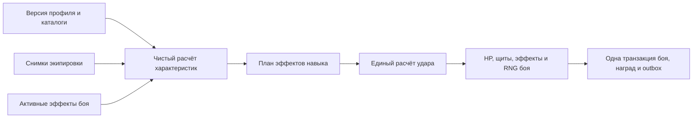

# Формулы боя: исследование Perfect World и адаптация к пошаговой игре

Статус: исследование и рекомендуемый проект, **не реализовано**. Действующие
правила остаются в [character.md](character.md), [combat.md](combat.md) и
[modifiers.md](modifiers.md). Документ не разрешает автоматически менять баланс,
старые предметы или активные бои. Дата исследования: 31 октября 2026 года.

## 1. Вывод и границы исследования

Рекомендуется перенести из PW взаимное усиление характеристик и экипировки,
разделение источников прибавок и относительное снижение урона. Стоимость
действия, сроки эффектов и полезность случайных исходов следует рассчитывать
в собственных ходах участников. Энергию поля и одно действие за ход сохранить.

Проверен публичный `huzeming/176source`, ревизия
`c0992a29c0848de4de139a8958ceb11edcf2d38b`. Это поздняя модифицированная
публикация: в активном коде есть изменения с пометками 1.7.4+, новые классы,
Lua-хуки и авторские правки. Её происхождение от конкретной оригинальной
сборки не удостоверено. Полные проверяемые исходники оригинальных 1.3.6–1.5.5
не получены; тождество формул и констант во всём этом диапазоне не установлено.
Сервер PW и оригинальные `elements.data` для численного сравнения не запускались.

Ниже **PW-факт** означает прочитанный активный код указанной публикации;
**адаптация** — наше проектное решение; **пример** — проверяемую арифметику,
которая не означает утверждённый игровой баланс. Закомментированные реализации
не считаются действующими. В частности, `UpdateAttack` читается из `.cpp`,
а закомментированный дубль в `.h` не используется как доказательство.

## 2. Проверяемые источники PW

Все ссылки закреплены на одной ревизии; номера строк относятся к ней.

| Источник | Функции и предмет проверки |
| --- | --- |
| [playertemplate.cpp:255](https://github.com/huzeming/176source/blob/c0992a29c0848de4de139a8958ceb11edcf2d38b/cgame/gs/playertemplate.cpp#L255) | `__LoadDataFromDataMan`: коэффициенты классов из `CHARRACTER_CLASS_CONFIG` |
| [playertemplate.cpp:506](https://github.com/huzeming/176source/blob/c0992a29c0848de4de139a8958ceb11edcf2d38b/cgame/gs/playertemplate.cpp#L506) | `__LevelUp`, `__UpdateBasic`, `__GetBasicAttackRate`, `__GetBasicArmor`: уровень, первичные, HP/MP, точность и уклонение |
| [playertemplate.cpp:880](https://github.com/huzeming/176source/blob/c0992a29c0848de4de139a8958ceb11edcf2d38b/cgame/gs/playertemplate.cpp#L880) | Активный `property_policy::UpdateAttack`: выбор первичного параметра оружия и физическая атака |
| [playertemplate.h:443](https://github.com/huzeming/176source/blob/c0992a29c0848de4de139a8958ceb11edcf2d38b/cgame/gs/playertemplate.h#L443) | `GetDamageReduce`, `CalcAntiDef`: поглощение и отдельное уменьшение защиты |
| [playertemplate.h:850](https://github.com/huzeming/176source/blob/c0992a29c0848de4de139a8958ceb11edcf2d38b/cgame/gs/playertemplate.h#L850) | `UpdatePlayerBaseProp`, `UpdateCrit`, `UpdateMagic`, `UpdateDefense`: HP, крит, магия и защиты |
| [actobject.h:1559](https://github.com/huzeming/176source/blob/c0992a29c0848de4de139a8958ceb11edcf2d38b/cgame/gs/actobject.h#L1559) | `GeneratePhysicDamage`, `GenerateMaigicDamage2`, `GenerateAttackDamage`, `DoDamageReduce`: бросок, коэффициент навыка, поздние прибавки |
| [actobject.cpp:515](https://github.com/huzeming/176source/blob/c0992a29c0848de4de139a8958ceb11edcf2d38b/cgame/gs/actobject.cpp#L515) | `AttackJudgement`, `HandleAttackMsg`: попадание, сопротивления, крит и attack/defense levels |
| [obj_interface.cpp:3117](https://github.com/huzeming/176source/blob/c0992a29c0848de4de139a8958ceb11edcf2d38b/cgame/gs/obj_interface.cpp#L3117) | `CalcPhysicDamage`, `CalcMagicDamage`: применение коэффициента защиты |
| [config.h:142](https://github.com/huzeming/176source/blob/c0992a29c0848de4de139a8958ceb11edcf2d38b/cgame/gs/config.h#L142) | Базовый критический множитель `2.0`; коэффициенты регенерации |
| [playerwrapper.h:158](https://github.com/huzeming/176source/blob/c0992a29c0848de4de139a8958ceb11edcf2d38b/cskill/skill/playerwrapper.h#L158) | Передача `ratio`/`plus` в генератор атаки; отдельная вероятность эффекта |
| [skill1.h:97](https://github.com/huzeming/176source/blob/c0992a29c0848de4de139a8958ceb11edcf2d38b/cskill/skills/skill1.h#L97), [skill98.h:102](https://github.com/huzeming/176source/blob/c0992a29c0848de4de139a8958ceb11edcf2d38b/cskill/skills/skill98.h#L102) | Примеры зависимости `plus`, `ratio`, точности и эффекта от ранга навыка |
| [skillfilter.h:105](https://github.com/huzeming/176source/blob/c0992a29c0848de4de139a8958ceb11edcf2d38b/cskill/skill/skillfilter.h#L105) | `filter_Incdefence`: срок, повторное наложение, присоединение и снятие бонуса |

Численные коэффициенты классов нельзя восстановить по одним полям загрузчика.
Найденный `ptemplate.conf` не принимается за актуальные настройки всех классов:
загрузчик использует также бинарный каталог. Таблица конкретных HP за единицу
выносливости по оригинальным классам остаётся неподтверждённой.

## 3. Формулы в просмотренном PW

Здесь `S` — сила, `A` — ловкость, `I` — `energy` PW, `V` — выносливость.
`energy` PW означает первичный магический параметр, **не наш запас энергии**.
`defense` означает физическую защиту; `armor` в проверке попадания — уклонение.
`attack` в `extend_prop` — точность, а не наносимый урон.

### 3.1. Первичные, уровень и экипировка

PW-факт: HP/MP получают рост уровня и классовые прибавки от `V`/`I`.
Точность и уклонение растут от `A` с коэффициентами класса. Физическая атака
обычного оружия масштабируется силой, дальнего и некоторых других типов —
ловкостью. Исключение для варвара с пометкой 1.7.4+ не переносится в старые версии.

В обычной ветке, без конвертации и рун, физическая атака имеет форму:

```text
P = round((baseDamage + weaponDamage + flatBefore)
          × (1 + round(100 × X / 150) / 100 + percentAttack / 100))
    + flatAfter
X = выбранная оружием сила или ловкость
```

Это вычисляется для нижней и верхней границ. Магическая атака использует
`I / 100` вместо приблизительного `X / 150`.
Первичные также усиливают защиту поверх её базовой/предметной части:

```text
defensePercentFromStats = round((2V + 3S) / 25)       // проценты
defenseFlatFromStats    = floor((V + S) / 4)
resistPercentFromStats  = round((2V + 3I) / 25)
resistFlatFromStats     = floor((V + I) / 4)
```

Сначала применяется процент к базовой защите с соответствующими прибавками,
затем плоская часть и отдельные поздние прибавки. Поэтому одинаковый процент
характеристики полезнее при лучшей экипировке. Полная воспроизводимость требует
сохранить промежуточные округления PW; для нашей новой версии предлагается
собственная единая политика точности, описанная ниже.

### 3.2. Броня и сопротивления

PW-факт:

```text
K = 40 × (attacker_level + highest_level) − 25
reduction = min(0.95 + inc_max_defense, D / (D + K))
afterArmor = incoming × (1 − reduction)
```

`D` выбирается по физическому либо одному из пяти магических типов.
Семантика дополнительного `highest_level` не отождествляется автоматически с
уровнем предмета или актуальным уровнем персонажа. Базовый cap 95% относится
именно к этому слою, а не ко всему снижению урона.

Пример при `attacker_level = 100`, `highest_level = 0`, `K = 3975`:

| D | Поглощение | Остаток от 100 урона, до округления |
| ---: | ---: | ---: |
| 0 | 0% | 100 |
| 1000 | 20.10% | 79.90 |
| 4000 | 50.16% | 49.84 |
| 8000 | 66.81% | 33.19 |
| 16000 | 80.10% | 19.90 |

Математическое свойство такой кривой: `d(reduction)/dD = K/(D+K)²`.
Прирост процента поглощения уменьшается плавно, без отдельного порога.
Однако до cap, при фиксированном K и без других слоёв,
`effectiveHP = HP × (1 + D/K)`: абсолютный прирост эффективного HP линейный.
Это не доказательство, что любая следующая единица брони бесполезнее для
каждого критерия баланса. После cap дополнительная броня всё ещё может
компенсировать дебафы; против неизменной атаки поглощение больше не растёт.

### 3.3. Навык, крит и попадание

PW-факт: `GeneratePhysicDamage(scale, plus)` сначала бросает атаку из диапазона,
затем складывает процент от первичного, процентные усиления и `scale` навыка;
после умножения добавляет позднюю плоскую прибавку и `plus`. Это не всегда
`итоговая атака × множитель навыка`: проценты могут входить в одну сумму.

Пример `skill1`: `plus = 1.9r² + 64r + 36.7`, `ratio = 0`.
Пример `skill98`: `plus = 4.2r² + 229.1r + 1577.4`, `ratio = 1.5 + 0.15r`.
Эти числа иллюстрируют форму развития, не являются балансом нашей игры.

Шанс крита от ловкости — примерно один процентный пункт за 20 A;
базовый крит ×2, его шанс и сила имеют отдельные поправки.
Для физического попадания в `AttackJudgement`:

```text
pHit = max(0.05, accuracy / (accuracy + floor(evasion / 2)))
```

Проверка привязана к `PHYSIC_ATTACK`; магические и гарантированные физические
ветки не должны автоматически получать ту же проверку. Ограничение сверху
95% в этом месте закомментировано, считать его действующим нельзя.
Критический бросок сравнивается с `crit_rate − crit_resistance`; множитель
учитывает отдельное снижение силы крита у цели.

### 3.4. Остальные слои

PW-факт: есть отдельное процентное уменьшение/усиление получаемого урона,
фильтры эффектов, модификаторы PvP/PvE и разницы attack/defense levels.
Для последней в просмотренной ветке, при `delta = attackDegree − defendDegree`:

```text
delta >= 0: factor = 1 + 0.01 × delta
delta <  0: factor = 1 / (1 − 0.012 × delta)
```

Это вторичные рейтинги, не уровни персонажа, навыка или вещи. Они отличаются
от обычной брони. Аналогично `CalcAntiDef` уменьшает защиту, тогда как
`GetPenetrationEnhance` даёт отдельное усиление против NPC: одинаковые бытовые
названия «пробивание» не означают одинаковую математику.

Проверенный `filter_Incdefence` хранит время и величину, обновляет бонус при
слиянии и снимает его при завершении. Время и серверный heartbeat не являются
готовым правилом длительности для нашей пошаговой игры.

## 4. Что отличается у нас сейчас

Выводы относятся к рабочему дереву на дату исследования, включая уже
реализованные общие допы. Это дополнение к историческому
[аудиту](architecture/GAME_MECHANICS_AUDIT.md), а не переописание его ревизии.

| Участок | Фактическая реализация | Следствие |
| --- | --- | --- |
| [defaults.ts:19](../packages/core/src/attributes/defaults.ts#L19) | `HP = 12V`, без собственного роста HP от уровня | Выносливость определяет всю базовую живучесть |
| [defaults.ts:20](../packages/core/src/attributes/defaults.ts#L20) | Мощь `0.6S + 0.2A`; магия `0.8I`; защиты — линейные суммы | Нет выбора главного параметра по типу оружия; ловкость повышает защиту, а не уклонение |
| [equipment.ts:6](../packages/core/src/attributes/equipment.ts#L6), [calculation.ts:111](../packages/core/src/attributes/calculation.ts#L111) | Масштабирование оружия уже есть: `B + W × (1 + B/20)` | Полезный принцип PW частично реализован; менять инфраструктуру экипировки не требуется |
| [damage.ts:5](../packages/core/src/combat/damage.ts#L5) | Обычный урон сразу включает коэффициент и крит, затем вычитает защиты | Высокая защита создаёт область ударов по 1 |
| [damage.ts:24](../packages/core/src/combat/damage.ts#L24), [effect-expression.ts:5](../packages/core/src/formulas/effect-expression.ts#L5) | Составной путь округляет raw до крита; обычный — иначе | Эквивалентные формулы могут давать разные результаты |
| [defaults.ts:26](../packages/core/src/attributes/defaults.ts#L26) | Удача повышает шанс и силу крита | Две перемножающиеся выгоды от одной характеристики |
| [skill-effects.ts:44](../packages/core/src/effects/skill-effects.ts#L44) | Атака фиксируется до каста; эффекты выполняются по порядку, защита цели читается при ударе | Дебаф защиты перед ударом влияет сразу; собственный баф атаки не усиливает raw того же каста |
| [lifecycle.ts:66](../packages/core/src/effects/lifecycle.ts#L66) | Бафы живут по собственным ходам цели | Подход уже соответствует пошаговой игре |
| [types.ts:138](../packages/core/src/types.ts#L138) | У `Fighter` нет самостоятельного боевого уровня | Для K от уровня требуется явный снимок уровня героя и эквивалент уровня NPC |

У нас пять первичных и четыре стихии, в рассмотренном PW — четыре первичных
и пять стихий. Добавлять металл/дерево или убирать воздух для копирования
формул не требуется. Ранг вещи определяет число допов, itemLevel — величину:
это согласованное правило [modifiers.md](modifiers.md), оно сохраняется.

## 5. Рекомендуемая адаптация характеристик

Это предложение для новой версии формул. Оно не меняет текущие определения.

| Первичная | Рекомендуемая роль | Ограничение |
| --- | --- | --- |
| Сила | Масштабирование силового оружия, небольшой вклад в физическую защиту | Не даёт точность и универсальное усиление всех типов урона |
| Ловкость | Масштабирование ловкого оружия; резерв для точности/уклонения | Не должна одновременно давать большой урон, броню, крит и дополнительные ходы |
| Интеллект | Магическая атака, лечение, небольшой вклад в сопротивления | Не увеличивает запас/пассивную генерацию энергии поля |
| Выносливость | HP, умеренный вклад в защиты и временную защиту поля | Проверять двойное усиление HP и брони через effectiveHP |
| Удача | Шанс крита | Силу крита развивать отдельно; не повышать автоматически шанс каждого допа |

Распределение пяти очков за уровень и уже вложенные первичные сохранить.
Предлагается небольшая гарантированная база HP от уровня плюс вклад V:
`HP = baseHp(profile, characterLevel) + hpPerVitality × V + itemHp`,
после чего действуют явно определённые процентные/временные модификаторы.
`baseHp` не должен повторно включать уже учтённый вклад V. Для миграции следует
сравнить сохранённые распределения и дать возможность пересмотра, если
относительная ценность характеристик существенно изменится.

Для атаки рекомендуются профиль оружия и две явно доступные величины:

```text
attackBase = bodyBase(profile, characterLevel) + weaponBase + flatBefore
attack = attackBase × (1 + primaryContribution(profile, effectivePrimaries)
                        + sum(passiveAttackPercent)) + flatAfter
raw = a(skillRank) × attack + b(skillRank) × attackBase + c(skillRank)
```

Это наша композиционная модель. В ней `a=1`, `b=ratio`, `c=plus` воспроизводят
описанный выше тип PW-навыка без обязательного перемножения всех процентов.
Другие коэффициенты дают привычные навыки «150% атаки + 20». `attackBase`
включает явно перечисленные источники и не должен называться «урон оружия»,
если содержит также тело и допы. Отдельный `weaponBase` нужен только навыку,
который действительно масштабируется исключительно от оружия.

Не нужно вводить классы ради коэффициентов. Начать с небольшого каталога
профилей оружия; профиль персонажа добавлять при реальной необходимости.
Существующее масштабирование можно сохранить для совместимого профиля;
PW-подобный профиль следует сравнить с ним на одинаковых бюджетах экипировки.

## 6. Рекомендуемый расчёт удара

```text
D = max(0, соответствующая итоговая защита цели + guardRating)
K = kBase + kPerLevel × (combatLevel атакующего − 1), K > 0
R = min(armorReductionCap, D / (D + K))
critical = 1 или отдельный критический множитель
mitigated = raw × critical × (1 − R) × product(damageTakenFactors)
beforeShield = raw > 0 ? max(1, floor(mitigated)) : 0
absorbed = min(beforeShield, доступное поглощение щитов)
hpLoss = min(target.hp, beforeShield − absorbed)
```

Явный иммунитет обнуляет результат до правила минимального урона. Успешный
щит может полностью поглотить удар. Защита не становится отрицательной;
иммунитет нельзя моделировать бесконечной бронёй. В первой версии новые
множители получаемого урона не нужны, если для них нет контента.

`combatLevel` фиксируется при старте: уровень героя, заданный эквивалент для
NPC, либо значение нормализации конкретного режима. До определения уровней
NPC режим использует один фиксированный K для всех участников. Нельзя молча
подставлять itemLevel, ранг вещи или ранг навыка. Проценты поглощения вне боя
показываются относительно явно указанного опорного уровня противника.

Форма `D/(D+K)` рекомендуется; значения `40`, `−25`, `95%` не переносить как
готовый баланс. Черновой K=30 из старого проекта эффектов — только точка для
сравнения: текущая броня 3 при нём поглощает около 9.1%. Подмена формулы без
пересмотра масштаба предметов и guard резко меняет ценность защиты.

При одинаковой процентной защите и без округления крит ×1.5 сохраняет ×1.5
прошедшего урона. Сейчас `100−80=20`, а `150−80=70`: эффективность крита
зависит от близости к порогу плоской защиты. Новая кривая устраняет этот порог.

### Прибавки, дебафы и точность вычисления

- `+20% защиты` изменяет D, а не R. При D=K это переход с 50% к 54.55%
  поглощения. `−20% получаемого урона` — другой эффект.
- Проценты одной группы складываются; независимые множители применяются
  отдельно только при явно заданном смысле. Не наследовать порядок случайно
  из порядка предметов или строк SQL.
- Новые прибавки к базовой атаке проходят формулу защиты. Существующий
  `physicalDamageFlat`, который добавляется после крита/защит на каждый удар,
  сохранить в старом профиле. Менять его смысл без отдельного решения и
  оценки созданных допов нельзя. Называть его безусловным true damage неверно:
  действующая формула также ограничивает всю сумму минимумом 1.
- BigInt/рациональные промежуточные значения; округление характеристик на
  выходе их расчёта, урона — один раз перед щитом. Не округлять отдельно
  `raw`, затем крит и броню. Простые и составные навыки идут одним путём.
- Вернуть структурированный `DamageResolution`: raw, тип, крит, поглощение
  бронёй, щитом и реальную потерю HP. Overkill не становится лечением от вампиризма.

## 7. Вторичные показатели и стоимость хода

| Показатель | Предложение для нашей игры | Почему |
| --- | --- | --- |
| Шанс крита | Сохранить отдельный рейтинг от удачи; cap настраивается | Одно понятное назначение первичной характеристики |
| Сила крита | Базовый множитель и отдельные допы; сравнить ×1.5 и ×2 | Полный ход делает большой крит более значимым, чем один частый удар MMORPG |
| Точность/уклонение | Не включать массово вместе со сменой брони; вынести в отдельный эксперимент | Промах основного действия теряет весь ход и вложенную энергию |
| Сопротивление эффектам | Отдельно по тегу эффекта, если появится соответствующий контент | Физическая броня не должна автоматически защищать от любого контроля |
| Шанс допа | Сохранить базовый шанс назначения и разрешённый рост от ранга навыка | Удача не должна скрыто менять все согласованные вероятности |
| Пробивание | При необходимости сначала один понятный способ уменьшения D | Не смешивать armor penetration с PvE-усилением позднего PW |
| Вампиризм | Процент от фактически снятых HP, с заданными источниками | Щит, overkill и периодический урон требуют явных правил |
| Регенерация | Только явный эффект/параметр с начислением за собственный ход | Секунды и heartbeat PW нельзя переносить буквально |
| Скорость атаки/каста | Не преобразовывать в бесплатные действия; не вводить в первую версию | Дополнительные ходы умножают энергию, бафы и контроль |
| Attack/defense levels, spirit, PvE-рейтинги | Отложить | Уже усиливают несколько перемножающихся слоёв и усложняют допы |

Для отдельного эксперимента с точностью можно использовать ограниченную
кривую PW: `clamp(accuracy/(accuracy + evasion/2), pMin, pMax)`, с явно
заданными поведением при нулевых рейтингах и коэффициентом точности навыка.
Это не утверждённая механика. Основные атаки пока гарантированно попадают;
`activationChanceBps` эффектов и крит сохраняют самостоятельный смысл.

Для будущего сопротивления эффекту кандидат:
`pFinal = pAssigned(rank) × (1 − resistForTag)`, после явного иммунитета.
Это **наша** формула, не подтверждённая универсальная формула контроля PW.
Решение о сопротивлении принимается до броска; журнал хранит итоговую
вероятность и причину отказа. Успешный баф не перебрасывается каждый ход.

## 8. Адаптация бафов, многоударности и поля

Длительность задаётся числом собственных ходов цели; ход наложения не
расходуется. Сохранить действующие `eligibleFromTurn` и правило истечения.
Перезарядка также задаётся собственными ходами, а не `ceil(seconds / N)`.
Повышение ранга не обязано удлинять контроль: целый дополнительный ход —
большое усиление. Бюджет контроля считать в ожидаемых потерянных действиях.

Например, доп с шансом 20% в среднем требует пяти допустимых применений.
Пять ударов могут произойти за короткий интервал MMORPG; у нас это минимум
пять собственных действий, а ограничения типа клеток и энергии могут сделать
ожидание ещё длиннее. Частоту оценивать по доступным кастам, а не числу секунд.

Составной навык сохраняет снимок атакующих характеристик до начала каста.
Дебаф защиты перед ударом меняет защиту этого удара; собственный баф атаки
перед ударом не пересчитывает уже подготовленный raw. Это действующая
семантика, её изменение должно быть отдельным решением.

Каждый объявленный удар может иметь свой крит. Вероятность дополнительных
эффектов не должна случайно умножаться числом внутренних ударов: для будущих
проков требуется явная политика «на каст/цель» либо «на удар» и общий ключ
броска для связанных эффектов. Сейчас движок проверяет каждый эффект/цель
отдельно; автоматическая группировка не реализована. Например, три независимых
шанса 20% дают 48.8% хотя бы одного успеха, а не 20%.

Для первой адаптации брони рекомендуется **сохранить смысл guard**: это
добавочный рейтинг ко всем применимым защитам до начала следующего собственного
хода, без расходования от удара. Он входит в D перед кривой; величина за клетку
перебалансируется. Превращение guard в расходуемый щит — отдельная альтернатива:
она меняет командный бой и соотношение одиночных/частых ударов, не является
техническим следствием новой брони. Щиты навыков остаются отдельным ресурсом.

Энергия 0–30, обязательная перестановка, открытие навыка прямым типом и одно
применение навыка/зелья сохраняются. По текущему порядку [combat.md](combat.md)
прямые клетки усиливают силу навыка: `1 + max(0, direct.count − 3) × 0.3`;
вторичные клетки дают энергию только после применения навыка или пропуска.
Время ходов и реальный таймер подключения не должны влиять на формулы.

## 9. Модули, данные и выполнение



Реализация остаётся в `packages/core`: расчёт профиля, компиляция простого
навыка в план, разрешение удара и эффекты. Это чистые функции с переданным RNG,
без SQL/Nest/HTTP. `ContentService` собирает и проверяет профиль; `battles`
владеет временным состоянием и командной транзакцией. Новые сервисы хранения
защит или активных бафов не нужны.

Рекомендуемая модель данных, имена предварительные:

| Данные | Владелец и правило |
| --- | --- |
| Профиль формул `id/version`, коэффициенты HP/атаки/защит, K, caps | Каталог баланса; целиком фиксируется в снимке боя |
| Профиль масштабирования оружия | Домен items; ссылается на известные характеристики, не на ID конкретного навыка |
| `combatLevel`, выбранный профиль героя/NPC | Снимок участника при старте; не читается заново из персонажа на каждом ударе |
| Вложенные первичные, навыки, экземпляры вещей | Существующее постоянное состояние соответствующих доменов |
| HP, временные эффекты, щиты, часы, результаты и RNG | Агрегат боя; одна атомарная запись на команду |
| Публичный результат | Серверные величины и вероятности; внутреннее состояние RNG не публикуется |

Новая версия формул должна различаться с текущими `combatVersion:1`,
`effectsVersion:1`, `modifierRulesVersion:1`. Эти поля уже имеют другой смысл;
проверять наличие статов вместо версии математических правил недостаточно.
Отсутствие нового профиля означает прежний расчёт, а не пересчёт при загрузке.

Не нужен универсальный язык скриптов. Линейные зависимости оставить в реестре;
деление, clamp и выбор типа брони — небольшой набор типизированных чистых
обработчиков. Текущий граф `StatDefinition` описывает линейные суммы и сам по
себе не выражает все новые произведения/зависимость от уровня: нужен явный
профиль расчёта и его валидатор, а не тайное изменение существующего DSL.

Команда: проверить версию/фазу/цель/ресурсы → построить снимок и план →
разрешить вероятности и удары в стабильном порядке → применить HP/эффекты →
проверить окончание боя → сохранить бой/награды/outbox → отправить результат.
Исключение откатывает всё вместе с RNG. Конкурентный/повторный запрос с прежней
версией получает существующий 409 и не перебрасывает исход. Для полного replay
нужно перевести также поле и NPC с `Math.random` на сохраняемые потоки RNG;
скрытие seed не делает используемый LCG криптографически непредсказуемым.

## 10. Настройки, проверка баланса и переход

Начальные численные коэффициенты **не утверждены**. В будущем каталоге
баланса должны быть заданы `hpBase/hpPerLevel/hpPerVitality`, профиль первичного
масштабирования, `kBase/kPerLevel`, cap брони, базовая сила/предел крита и
стоимость рейтинга guard за клетку. При старте отсутствие обязательной настройки
или K≤0 отклоняет профиль, не приводит к скрытой подстановке числа из PW.
Требуются `kBase > 0`, `kPerLevel ≥ 0`, `0 ≤ armorReductionCap < 1`, конечные
неотрицательные рейтинги и заданные границы всех множителей; это проверяется
для всего поддерживаемого диапазона уровней и при публикации контента.
Для сравнения использовать текущий профиль как baseline, K=30 как имеющийся
черновик и нормированные альтернативы K. Это варианты опыта, не новые defaults.

Баланс измерять одинаковыми бюджетами очков и предметов на низком, среднем
и высоком уровнях; отдельно при равном уровне и при разнице уровней. Нужны
не только средний урон, но медиана и 90-й процентиль действий до победы,
частота убийства одним ходом, ожидаемая доля потерянных от контроля действий,
эффективность лечения/guard и длительность командного фокуса.
Целевое число действий до победы выбирается продуктово; без него нельзя
обосновать cap 95%, HP за V или скорость роста оружия как оптимальные.

| Этап | Результат | Стоимость/риск |
| --- | --- | --- |
| 1. Зафиксировать контрольные примеры | Эквивалентность простых/составных навыков, округление, overkill, flat damage | Низкая; без смены баланса |
| 2. Ввести профиль и единый resolver за версией | Прежние snapshots дают прежний результат; новый путь тестируется отдельно | Средняя; затрагивает два пути урона |
| 3. Сравнить кривую защиты и guard | Чистая симуляция, выбранные масштабы рейтингов и cap | Средняя; основной риск перебалансировки экипировки |
| 4. Сравнить рост HP и профили атаки | Понятная роль каждой первичной, определённый уровень NPC | Средняя; требуется проверка существующих билдов |
| 5. Запустить выбранный профиль для новых боёв | Полный снимок правил; старые бои не меняются | Средняя; откат возвращает профиль только для последующих боёв |
| 6. Отдельно исследовать дополнительные рейтинги | Точность, сопротивление контролю, вампиризм — только при нужном контенте | Не предпосылка первых пяти этапов |

Проверки будущей реализации: монотонность атаки/HP/защит; убывание прироста
процента поглощения; линейность EHP до cap; отдельные типы сопротивлений;
armor debuff перед ударом; одинаковое округление путей; иммунитет/ноль/щит;
равные ожидаемые бюджеты многоударности; отсутствие повторного прока на тике;
сроки при нескольких противниках; смерть и лечение; rollback/retry/restart;
реплей с тем же RNG. Проверять арифметику независимыми контрольными значениями,
а не копией реализации в тесте. Тесты core должны работать без сервера.

## 11. Открытые решения

1. Целевая продолжительность дуэли и командного боя в собственных действиях.
2. Нужен ли уровень атакующего в K во всех режимах или нормализация арены.
3. Рост базового HP и атаки от уровня; коэффициенты предметных профилей.
4. Cap брони и допустимый максимум совокупного снижения разных слоёв.
5. Переход силы крита с удачи на отдельный показатель и компенсация билдов.
6. Судьба `physicalDamageFlat` в новом профиле и бюджет на несколько ударов.
7. Нужны ли вообще промахи основных атак и сопротивление контролю.

Эти вопросы не мешают фиксировать структуру формул и границы модулей, но
блокируют публикацию окончательных коэффициентов как сбалансированных.
